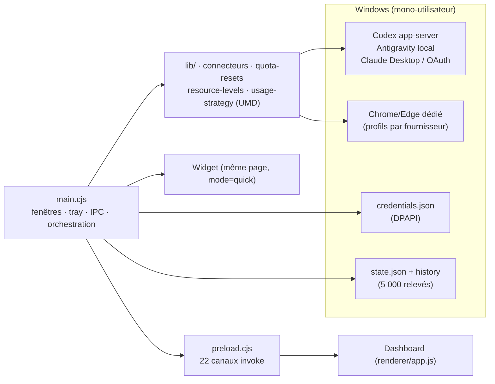

# ProvidersBar 0.2.1 — analyse consolidée

**Objet** : audit d'ingénierie d'une application Electron Windows de suivi des quotas et abonnements de dix fournisseurs d'IA.
**Dépôt** : `C:\Users\lasme\Desktop\projects\ProvidersBar` — branche `main`, 5 commits, version `0.2.1` (`package.json:3`).
**Méthode** : cinq agents d'analyse en parallèle, périmètres disjoints, lecture intégrale du code et de la documentation, aucun fichier source modifié. Les rapports détaillés sont dans [`analysis/`](analysis/) ; ce document les recoupe, déduplique et hiérarchise.
**Date de l'analyse** : 3 novembre 2026. Analyse statique + vérifications locales (`npm test`, `npm audit`, inventaire `dist/`) ; aucun service fournisseur interrogé.

---

## 1. Verdict en trente secondes

ProvidersBar est une application **personnelle, locale et étonnamment soignée sur ses fondations** : isolation Electron correcte, secrets chiffrés hors du renderer, connecteurs qui refusent d'inventer une valeur, migrations non destructives, documentation dense et majoritairement exacte. **Aucune vulnérabilité critique** n'a été trouvée, et les 135 tests unitaires passent en 1,45 s.

Ses faiblesses ne sont pas là où on les attend : elles sont **opérationnelles et produit**. Le runtime Electron livré est en retard de sécurité, les profils de session connectés sont exposés à un port de débogage local, les ACL Windows ne sont pas appliquées, la version affichée est fausse, l'interface n'est pas accessible (zoom, contrastes, focus), et le renderer est un monolithe sans test.

| Axe | Note | Lecture |
|---|---:|---|
| Architecture / modularité | **7,5 / 10** | Séparation nette `main`/`preload`/`lib`/`renderer`, mais `main.cjs` concentre trop de responsabilités |
| Sécurité / confidentialité | **7 / 10** | Conception 9/10, hygiène opérationnelle 4,5/10 |
| Fiabilité des connecteurs | **7,5 / 10** | Très défensif, mais quelques trous de correction et de concurrence |
| Tests / qualité | **7,5 / 10** | Noyau `lib/` ~90-95 % couvert, orchestration Electron et renderer non couverts, aucun CI |
| Interface / accessibilité / doc produit | **5,5 / 10** | Fonctionnelle et cohérente, pas accessible AA, dérive documentaire |
| **Consolidé** | **≈ 7 / 10** | **Excellent outil personnel ; pas prêt pour une distribution publique en l'état** |

---

## 2. Ce qu'est le produit

Application Electron mono-utilisateur (Windows x64, Node ≥ 24) qui agrège les quotas restants de dix fournisseurs — OpenAI/Codex, Claude, Grok, Antigravity, Z.ai, Ollama, OpenRouter, DeepSeek, RunInfra, OrcaRouter — dans un tableau de bord et un widget de zone de notification. Aucun serveur, aucune télémétrie : tout est local. Les clés API sont chiffrées via `safeStorage`/DPAPI, les sessions web vivent dans des partitions Chrome/Edge dédiées.

Chiffres clés : `main.cjs` **690 lignes**, 19 modules `lib/`, renderer `app.js` **65,5 Ko / 430 lignes**, 5 documents, 19 fichiers de tests, 22 canaux IPC, 0 canal `send` entrant.

---

## 3. L'équipe et ses livrables

| Agent | Mission | Livrable | Note |
|---|---|---|---:|
| `architecte` | Architecture, processus, IPC, modèle de données, packaging | [analysis/01-architecture.md](analysis/01-architecture.md) (466 l.) | 7,5 |
| `securite` | Secrets, isolation, surface locale, dépendances, confidentialité | [analysis/02-securite.md](analysis/02-securite.md) (338 l.) | 7 |
| `qualite-tests` | Exécution des tests, couverture, fragilités, CI | [analysis/03-tests.md](analysis/03-tests.md) (272 l.) | 7,5 |
| `connecteurs` | Parsing, erreurs, retries, concurrence, fuites, cycle de vie | [analysis/04-connecteurs.md](analysis/04-connecteurs.md) (471 l.) | 7,5 |
| `ux-docs` | Interface, accessibilité, thèmes, cohérence doc↔code, produit | [analysis/05-ux-docs.md](analysis/05-ux-docs.md) (573 l.) | 5,5 |

Chaque rapport contient les preuves `fichier:ligne`, les scénarios, une section « non vérifié » et des recommandations priorisées. Le présent document ne remplace pas ces rapports : il en donne la lecture décideur.

---

## 4. Points forts confirmés (à préserver)

1. **Frontière renderer↔main exemplaire pour une app Electron personnelle** : `sandbox`, `contextIsolation`, `nodeIntegration:false` systématiques (`main.cjs:652`), preload de 26 lignes sans capacité générique (`preload.cjs`), CSP stricte sans script inline (`renderer/index.html:6`), navigation et popups refusés (`main.cjs:231-236`).
2. **Garde IPC en profondeur** : chaque appel vérifie la frame principale **et** l'URL exacte de l'UI (`main.cjs:440-445`) ; 22 canaux métier, aucun accès `fs`/`shell`/`child_process` exposé.
3. **Aucun secret dans le renderer, le state ou l'export** : clés dans `credentials.json` chiffré DPAPI, refus d'enregistrer une clé si le chiffrement est indisponible (`main.cjs:522`), jetons OAuth Claude jamais copiés (`lib/claude-connection.cjs`). Vérifié sur les données réelles et par les tests.
4. **Honnêteté des données** : un format inconnu, un compteur ambigu ou un pourcentage hors bornes produit une **erreur**, jamais une estimation (`lib/connectors.cjs:9`, `lib/subscription-accounts.cjs:301-302`, `lib/antigravity-account.cjs:57`). Absent ≠ zéro, et devises jamais converties.
5. **Dernier relevé conservé avec son horodatage réel** en cas d'erreur, badge « Relevé ancien » au-delà de 10 min (`main.cjs:167-173`, `renderer/app.js:87`).
6. **Robustesse OAuth Claude Code de niveau industriel** : double verrou `.oauth_refresh.lock` + verrou historique, heartbeat 5 s / stale 60 s, adoption d'un jeton renouvelé par un autre processus, écriture atomique, cooldown `Retry-After` persistant (`lib/claude-connection.cjs:50-155`, `lib/claude-live-usage.cjs:102-115`).
7. **Persistance sûre** : `.tmp` + `rename` (`main.cjs:143-148`), file d'écriture sérialisée, store de clés qui ne publie qu'après succès disque (`lib/credential-store.cjs:9-19`).
8. **Migrations non destructives** : refus de démarrer sur format inconnu, sauvegardes `wx` non écrasables avant les deux migrations destructives (`main.cjs:621-648`).
9. **Réseau verrouillé** : GET only, `redirect:'error'`, `cache:'no-store'`, timeout 20 s, endpoints fermés aux dix fournisseurs, aucune télémétrie.
10. **Seuils produit exacts et centralisés** : rouge à 0, orange ≤ 2 USD / ≤ 10 %, jaune ≤ 5 USD / ≤ 25 %, vert au-delà (`lib/resource-levels.js:11-14`), conformes au README et testés.
11. **Documentation de conception de très bonne qualité** (`docs/architecture.md`, `docs/ordre-consommation.md`) et tests lisibles couvrant les cas difficiles (reprises réseau, 502/503/504, verrous, concurrence).
12. **Packaging avec rollback** : remplacement complet de `resources/app` en staging puis bascule, données préservées par `update-portable.cjs`.

---

## 5. Risques consolidés, dédupliqués et priorisés

### P0 — à corriger avant la prochaine version

| # | Risque | Preuve | Source |
|---|---|---|---|
| P0-1 | **Runtime Electron vulnérable et audit trompeur.** Electron `44.2.0` est le runtime réellement livré (`scripts/package.cjs:6,12`) mais déclaré en `devDependencies`, donc `npm audit --omit=dev` renvoie 0. Vérifié le 3/11 : audit complet = **2 vulnérabilités `high`** (`electron`, `undici`), correctif `electron@44.10.2`. Le nombre exact d'avis dépend de la base au moment de l'audit (l'agent en a vu 7 ; l'important est la classe : runtime livré non audité). | `package.json:19-22`, `npm audit` | 02 (E-1) |
| P0-2 | **Port CDP non authentifié sur les profils connectés.** Grok/Z.ai/Claude/OpenAI lancent Chrome/Edge avec `--remote-debugging-port=0` sur le profil **déjà connecté** ; tout processus local peut lire `DevToolsActivePort` et exfiltrer les cookies de session, contournant DPAPI. Exposition : quelques secondes toutes les 5 min, jusqu'à ~60 s en vérification interactive. Correctif : réutiliser le pattern `BrowserWindow` + `executeJavaScript` déjà utilisé pour Orca/Ollama (`main.cjs:298-307`), sans port local. | `lib/account-browser.cjs:52-62,91-98` | 02 (E-2), 04 (R-05) |
| P0-3 | **Quota OpenAI incomplet publié comme complet.** Le bucket `openai` de la stratégie n'a aucune fenêtre `required` (`lib/usage-strategy.js:21`) : une réponse Codex réduite à la fenêtre 5 h est acceptée et affichée « disponible » alors que la semaine peut être épuisée. À exiger : fenêtres 5 h **et** semaine par groupe principal, ou publier un relevé « incomplet ». | `lib/usage-strategy.js:21`, `lib/openai-account.cjs:58-74` | 04 (R-02) |
| P0-4 | **Version et marque incohérentes dans le produit livré.** Réglages affiche « Version 0.1.0 » en dur (`renderer/app.js:237`) et le client RPC Codex annonce `0.1.0` (`lib/openai-account.cjs:51`) alors que l'app est en 0.2.1 ; « L'atelier de Lasme » et l'avatar « L » sont codés en dur (`renderer/app.js:60`) et un smoke test l'exige (`scripts/smoke.cjs:24`), ce qui contredit la promesse de distribution sans données personnelles (`docs/maintenance.md:47`). | `renderer/app.js:60,237`, `lib/openai-account.cjs:51` | 01, 05 (M-08, M-11) |
| P0-5 | **Connexion Ollama/OrcaRouter perdue sur échec transitoire.** `accountSession` n'est écrit qu'après le premier fetch réussi (`main.cjs:321,422-428`) : un échec réseau juste après l'import des cookies laisse l'app « non connectée », sans reprise automatique, jusqu'à un clic manuel. | `main.cjs:321,408-428` | 04 (R-04) |
| P0-6 | **Vérification interactive Grok/Z.ai silencieusement dégradée.** Un clic « Vérifier maintenant » pendant un auto-refresh renvoie le travail de fond et perd le mode interactif (`lib/subscription-controller.cjs:15-18`) ; à l'inverse Ollama/Orca jettent « déjà en cours » (`main.cjs:312,397`). | `lib/subscription-controller.cjs:15-18,33` | 04 (R-06) |

### P1 — sous deux semaines

| # | Risque | Preuve | Source |
|---|---|---|---|
| P1-1 | **Aucune ACL Windows sur les données.** `mode:0o600` est inopérant sous NTFS (`main.cjs:146,631,644`) ; `credentials.json`, `state.json`, profils Chrome et **le code applicatif** héritent des ACL du dossier (bureau/USB). Sur cette machine, des SID de sandbox avaient Modify sur `dist/.../data` et `resources/app` (constat d'environnement à rejouer hors outillage). Correctif : `icacls /inheritance:r` ou déplacer les données sous `%LOCALAPPDATA%`. | `main.cjs:27,143-148` | 02 (M-1) |
| P1-2 | **Cooldowns 429 non persistés ; `Retry-After` partiellement ignoré.** Les clés API gardent leur cooldown en mémoire seulement (`lib/connectors.cjs:4,88-94`) : perdu au redémarrage. `Retry-After` n'est pas honoré sur les 5xx réessayés (délai fixe 350 ms) ni du tout par Ollama/Orca (`lib/ollama-account.cjs:100`, `lib/orca-account.cjs:25`). | `lib/connectors.cjs:4,75-97` | 04 (R-03) |
| P1-3 | **Lecture directe Claude et renouvellement OAuth hors proxy Windows.** Ils utilisent `globalThis.fetch` (`lib/claude-live-usage.cjs:54,60`, `lib/claude-connection.cjs:85,119`) au lieu de `session.defaultSession.fetch` (`main.cjs:33`) : proxy d'entreprise vraisemblablement ignoré (hypothèse non vérifiée). | `lib/claude-live-usage.cjs:54-60` | 04 (R-07) |
| P1-4 | **Coût et fuites du navigateur dédié.** Un Chrome complet est lancé toutes les 5 minutes pour Grok/Z.ai (`main.cjs:686`), l'arrêt n'est pas confirmé après 1,5 s + 2 s (`lib/account-browser.cjs:8-24`), et les profils temporaires ne sont pas balayés au démarrage (`:70-77`). | `main.cjs:686`, `lib/account-browser.cjs:8-24,54` | 04 (R-05) |
| P1-5 | **Navigation des fenêtres de compte trop permissive.** `will-navigate`/`will-redirect` autorisent **n'importe quelle** origine HTTPS, et `setWindowOpenHandler` autorise les popups HTTPS avec la session du compte (`main.cjs:257-263`) : hameçonnage dans une fenêtre de l'application. Allowlist par fournisseur attendue. | `main.cjs:257-263` | 02 (M-3) |
| P1-6 | **Export non conforme à la promesse « sans sessions ».** L'export sérialise tout `state` (`main.cjs:596`) : `accountSession` inclut le SHA-256 non salé de l'e-mail OpenAI (`lib/openai-account.cjs:83`) et les `userId`/`workspaceId` numériques OrcaRouter (`main.cjs:321`), ainsi que `claudeSync`. Pas de clé ni jeton, mais des identifiants pseudonymes exportés. | `main.cjs:80,321,593-597` | 01, 02 (F-3), 05 |
| P1-7 | **Rétention d'historique < 2 jours à pleine échelle.** Plafond 5 000 relevés (`main.cjs:172`) contre ~2 880 entrées/jour à 10 fournisseurs toutes les 5 min (`main.cjs:686`) : **≈ 1,7 jour** d'historique, alors que l'UI et l'export reposent dessus. | `main.cjs:172,686` | 01 |
| P1-8 | **`main.cjs` monolithique et non testé.** Fenêtres + tray + IPC + persistance + cas Orca/Ollama/Claude/OpenAI dans 690 lignes, dispatch en cascade (`main.cjs:206-217,479,540-578`) ; `main.cjs`, `preload.cjs` et `renderer/` sont à **0 %** de couverture `npm test`, et aucun CI n'existe. | `main.cjs`, `tests/` | 01, 03 |
| P1-9 | **Accessibilité bloquante.** Navigation inaccessible au zoom ≥ 125 % (sidebar `display:none` à 760 px alors que `minWidth` vaut 900 : `renderer/styles.css:1` vs `main.cjs:654`) ; contrastes AA insuffisants (axes graphique clair **2,47:1** avec `fill="#9da89b"` en dur `renderer/app.js:203`, labels 3,62–4,24, valeurs atténuées 2,75–4,26 par `opacity:.65` `renderer/styles.css:49`) ; focus perdu à chaque re-rendu complet. | 05 (§3, B-02, M-01..M-04) | 05 |
| P1-10 | **Promesses d'interface non tenues.** Le widget ne montre jamais la fraîcheur alors que le README la promet (`renderer/app.js:247-261` vs `README.md:3`) ; la statistique « actualisation toutes les 5 min » s'affiche même quand elle est désactivée et ignore la cadence Claude de 1 min (`renderer/app.js:70,237`). | `renderer/app.js:70,237,247-261` | 05 (M-06, M-07) |
| P1-11 | **Documentation produit périmée.** `docs/ordre-consommation.md:45` dit encore « deux groupes Antigravity » alors que trois réserves sont suivies depuis Argon (`lib/usage-strategy.js:29`, `docs/architecture.md:61`) ; notifications Windows jamais documentées (`main.cjs:180-196`) ; « migration sauvegarde » revendiqué pour 6 migrations alors que 2 seulement le font (`docs/architecture.md:5`). | docs + code | 01, 05 |

### P2 — industrialisation et finitions

| # | Sujet | Preuve | Source |
|---|---|---|---|
| P2-1 | Renderer monolithe : `app.js` 65,5 Ko/430 lignes, 17 lignes > 700 car. (max 2 387), re-rendu `innerHTML` complet toutes les 60 s, duplication cartes/widget/stratégie, CSS minifié puis surchargé, sélecteurs morts, HTML invalide (`button` > `div`/`h3`). | `renderer/app.js:60,203,237`, `renderer/styles.css:1` | 05 (§2) |
| P2-2 | Distribution publique non prête : aucune licence (repo privé sans `LICENSE`), ni politique de confidentialité, ni mise à jour pour non-développeur, ni signature Authenticode/`app.asar`, ni installateur ; marque personnelle. | racine dépôt, `scripts/package.cjs` | 02 (M-2), 05 (B-01, M-13) |
| P2-3 | Publication `dist/` non industrialisée : deux `.zip` (~163 Mo) et `SHA256SUMS*.txt` présents mais **aucun script ni procédure** ; le lanceur `Lancer ProvidersBar.cmd` cible le portable personnel et n'est pas dans la distribution. | `dist/`, `scripts/` (aucune occurrence) | 01 |
| P2-4 | Données et caches navigateur dans le même dossier (`userData` = dossier de données, `main.cjs:28`) ; sauvegardes `state.before-*.json` non purgées (~27 Mo observés) ; `state:get` déclenche écriture disque + broadcast (`main.cjs:447-450`) ; `announced` non borné. | `main.cjs:28,447-450,631,644` | 01, 02 (F-8) |
| P2-5 | Antigravity : `rejectUnauthorized:false` sur loopback avec fenêtre TOCTOU entre découverte et requête, découverte CIM/PowerShell potentiellement sensible à l'encodage, un bucket reconnu dont la `window` change fait échouer toute la lecture. | `lib/antigravity-account.cjs:8-47,55-57` | 02, 04 (R-08) |
| P2-6 | Données fournisseur acceptées trop libéralement : soldes négatifs non refusés (OpenRouter, RunInfra), dates ISO sans fuseau interprétées en heure locale, parseurs web `claude`/`openai` morts. | `lib/connectors.cjs:15-17,29-37`, `lib/antigravity-account.cjs:59` | 04 (R-09..R-15) |
| P2-7 | Zones sans tests : transport Codex RPC (64 %), lecteur CDP (23,65 %), notifications, packaging, renderer, aucun job CI Windows pour les smoke Electron. | `analysis/03-tests.md` | 03 |
| P2-8 | Qualité perçue : contrastes, typographies 8–10 px, pas de `prefers-color-scheme`, menu Electron anglais, pas de restauration de fenêtre, jargon et anglicismes (« providers », « Reset », « Free »), typos README (« Lancer Lancer », « puis Puis »). | `renderer/`, `main.cjs:654`, docs | 05 |

---

## 6. Vérifications indépendantes effectuées par le Lead

| Vérification | Résultat |
|---|---|
| `npm test` (exécuté deux fois) | **135 tests / 19 fichiers, 135 passés, 0 échec, ~1,45 s** (`node --test`, exit 0) |
| `npm audit` complet | **2 vulnérabilités `high`** directes/transitives (`electron`, `undici`) ; `--omit=dev` = **0** (trompeur car Electron, runtime livré, est une devDependency) |
| Version Electron installée | `44.2.0` (correctif disponible `44.10.2`) |
| `dist/` | Release 0.2.1 sans `data/` ; portable avec `data/` ; `.zip` + `SHA256SUMS` présents mais non scriptés |
| Constats ciblés | Version 0.1.0 en dur, « L'atelier de Lasme », flags `--remote-debugging-port=0`, bucket OpenAI sans `required`, `0o600` inopérant, `app.js` max 2 387 car./ligne : **tous confirmés** |

---

## 7. Corrections rapides (< 1 jour, fort rendement)

1. Afficher `app.getVersion()` (via `preload`) et utiliser la même valeur pour `clientInfo` Codex — supprime « Version 0.1.0 ».
2. Rendre le nom d'espace neutre (« Mon espace ») et retirer l'assertion personnelle du smoke test.
3. Corriger le README : « Lancer Lancer », « puis Puis », section Notifications, cas d'atténuation, watcher Claude conditionné à `autoRefresh`.
4. Mettre `docs/ordre-consommation.md` à jour (3 réserves Antigravity, Argon, cache écrit vs lu).
5. Conditionner l'affichage « toutes les 5 min » à `settings.autoRefresh` et mentionner la cadence Claude ; afficher la fraîcheur dans le widget (ou corriger le README).
6. Protéger `notify()` et le timer 5 min (`p.snapshot?.balances ?? []`, `try/catch` avec log).
7. `devTools:false` sur les fenêtres UI, en-tête `frame-ancestors` sur l'aperçu, purge `DevToolsActivePort`/`.tmp` au démarrage, purger les `state.before-*.json`.
8. Mettre à jour Electron vers 44.10.2 et auditer l'arbre complet avant chaque release (l'idéal : passer Electron en `devDependencies` assumée + étape d'audit dédiée, puisque c'est le runtime livré).

---

## 8. Plan de remédiation proposé

**Lot A — sécurité et correction (1 semaine).**
P0-1 Electron 44.10.2 + audit de release · P0-2 suppression du CDP TCP sur profils connectés · P1-1 ACL/`%LOCALAPPDATA%` · P1-5 allowlist de navigation · P0-3 fenêtres OpenAI obligatoires · P0-4 version/marque.

**Lot B — fiabilité (2 semaines).**
P0-5 reprise de connexion Ollama/Orca · P0-6 priorité au mode interactif · P1-2 cooldowns persistants et `Retry-After` · P1-3 transport proxy pour Claude · P1-4 cycle de vie Chrome · P1-7 rétention d'historique · tests de non-régression correspondants (03 §8 top 10).

**Lot C — produit et industrialisation (1 mois).**
P1-9 accessibilité (zoom, contrastes, focus) · P1-10/P1-11 promesses et docs · P2-1 modularisation du renderer · P1-8 extraction des logiques de `main.cjs` + tests + **CI Windows** exécutant `npm test` et les trois smoke Electron · P2-3 script de release zip/checksums · P2-2 licence, confidentialité, signature, mise à jour.

Ordre rationnel : **A** sécurise et corrige ce qui trompe l'utilisateur, **B** rend les lectures fiables, **C** rend le produit distribuable.

---

## 9. Limites de l'analyse

- Aucun service fournisseur interrogé et aucune exécution de l'application (pas de `npm start`, pas de smoke Electron) : les comportements dépendant des portails réels sont signalés « non vérifié » dans les rapports.
- Les smoke tests Electron (`test:desktop`, `test:resources:desktop`, `test:claude:desktop`) exigent une session graphique et n'ont pas été rejoués ; leur contenu a été analysé statiquement.
- Les ACL observées par l'agent sécurité incluent des SID d'outillage de développement : à rejouer sur un poste utilisateur standard.
- Le nombre d'avis `npm audit` varie avec la base d'avis ; la vérification du 3/11 donne 2 `high`, l'agent en avait relevé 7 — la conclusion (runtime livré vulnérable, audit prod trompeur) est robuste, le décompte exact doit être refait à la release.
- Le tableau de bord mobile Tailscale a été **retiré** (commit `f537ba0`) : sa réintroduction ouvrirait une surface réseau entièrement nouvelle, à réauditer.

---

## 10. Index des preuves

| Sujet | Rapport détaillé |
|---|---|
| Architecture, IPC, cycle de vie, données, packaging | [analysis/01-architecture.md](analysis/01-architecture.md) |
| Sécurité, secrets, isolation, dépendances, threat model | [analysis/02-securite.md](analysis/02-securite.md) |
| Tests, couverture, fragilités, CI, top 10 des manques | [analysis/03-tests.md](analysis/03-tests.md) |
| Connecteurs, parsing, erreurs, concurrence, fuites | [analysis/04-connecteurs.md](analysis/04-connecteurs.md) |
| Interface, accessibilité, documentation, produit | [analysis/05-ux-docs.md](analysis/05-ux-docs.md) |
