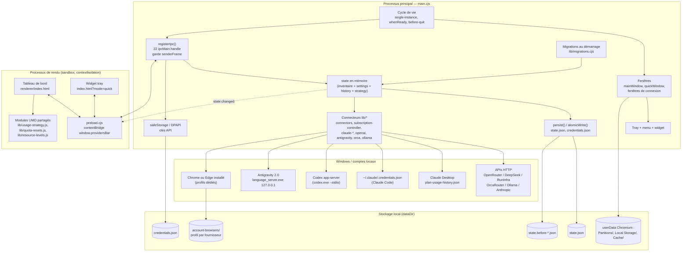

# Analyse d'architecture — ProvidersBar 0.2.1

**Rapport** : analyse d'architecture, du processus principal, de l'IPC et du modèle de données.
**Application** : ProvidersBar 0.2.1 (`package.json:3`), Electron 44.2.0 (`package.json:20`), Windows x64.
**Méthode** : lecture intégrale du code (aucune exécution : pas de `npm start`, pas de build, pas de test). Tous les constats sont appuyés par `fichier:ligne`. Les points non observables en lecture statique sont explicitement marqués **non vérifié**.
**Périmètre lu** : `main.cjs` (690 lignes), `preload.cjs` (26), `lib/*.cjs|js` (18 modules), `renderer/*`, `scripts/*`, `tests/*` (survol), `package.json`, `docs/architecture.md`, `docs/maintenance.md`, `docs/validation-0.2.0.md`, `CHANGELOG.md`, `README.md`, `.gitignore`, arborescence `dist/`.

> Note de comptage : la tâche annonce `main.cjs` à 687 lignes ; le fichier en compte **690** (lecture directe, et identique dans `dist/ProvidersBar-win32-x64/resources/app/main.cjs`).

---

## 1. Synthèse

ProvidersBar est une application Electron mono-processus principal (`main.cjs`) qui expose à un renderer local une **surface IPC de 22 canaux `invoke`**, sans aucun canal `send`/`on` entrant ni API système générique. Le renderer est sandboxé, isolé, sans Node.js (`main.cjs:652`), servi par `loadFile` depuis le disque (`main.cjs:658`, `662`), et un pont explicite de 26 lignes (`preload.cjs`) expose une API métier nommée.

L'architecture est **modulaire côté `lib/`** (connecteurs, moteurs purs partagés, contrôleurs) mais **centralisée côté `main.cjs`** : fenêtres, tray, widget, IPC, persistance, orchestration des connexions et cas particuliers de quatre fournisseurs (OrcaRouter, Ollama, Claude, OpenAI) cohabitent dans un seul fichier. Les choix de robustesse sont réels et argumentés (écriture atomique, migrations non destructives, isolation des sessions de compte, validation stricte des entrées, aucun secret dans les données applicatives), mais la dette est concentrée dans `main.cjs` : état global mutable, effets de bord dans les getters, persistance non temporisée, rétention d'historique courte, et quelques marqueurs de version/personne restés en dur dans le code distribué.

---

## 2. Schéma des composants



Lecture du schéma : il n'existe **qu'un seul pont** entre le rendu et le système — `preload.cjs` — et **qu'un seul écrivain** de l'état — le processus principal. Le renderer ne touche jamais le disque, le réseau, DPAPI ni les processus ; il ne reçoit que des projections de `state` (`main.cjs:154-157`).

---

## 3. Modules → responsabilités → dépendances

| Module (lignes) | Responsabilité | Dépend de |
| --- | --- | --- |
| `main.cjs` (690) | Processus principal : cycle de vie, fenêtres/tray/widget, **les 22 canaux IPC**, orchestration des synchronisations, état en mémoire, persistance, notifications, migrations au démarrage, intégrations spécifiques Orca/Ollama/Claude/OpenAI | Electron (`app`, `BrowserWindow`, `ipcMain`, `Tray`, `Menu`, `safeStorage`, `session`, `powerMonitor`, `dialog`, `Notification`, `screen`), `node:fs/promises`, `node:fs` (`watchFile`), tous les modules `lib/` |
| `preload.cjs` (26) | Pont `contextBridge` : 22 méthodes `invoke` + abonnement `state:changed` ; aucune autre capacité | `electron` (`contextBridge`, `ipcRenderer`) |
| `lib/domain.cjs` (97) | Validation des patchs d'inventaire (`validatePatch`), construction des relevés manuels (`manualSnapshot`), budget mensuel (`summary`), échéances (`daysUntil`, `expireSubscriptions`), règle de suivi (`isTracked`), normalisation Ollama Free (`asOllamaFreeSnapshot`) | Aucune (module pur) |
| `lib/seed.cjs` (28) | Inventaire initial des 10 fournisseurs + réglages par défaut | Aucune |
| `lib/migrations.cjs` (83) | 6 migrations d'inventaire : retrait de services, nettoyage des métadonnées d'import, ajout Antigravity/Claude, normalisation de présentation, purge des relevés OrcaRouter invalides | `lib/seed.cjs` (require paresseux, `migrations.cjs:58,67`) |
| `lib/provider-catalog.cjs` (59) | Catalogue de connexion : mode (`account`/`api`), libellés, instructions, endpoints API ; `connectionInfo()` retire l'endpoint avant envoi au renderer | `lib/subscription-accounts.cjs` |
| `lib/connectors.cjs` (103) | Lecture des soldes API (OpenRouter, DeepSeek, RunInfra) : validation de clé, GET only, timeout, retry borné, parsing strict, cooldowns 429 | `lib/provider-catalog.cjs`, `node:crypto`, `node:timers/promises` |
| `lib/credential-store.cjs` (23) | Store en mémoire sérialisé des clés chiffrées, publication après écriture disque réussie | Aucune (injecté `write`) |
| `lib/credential-store.cjs` → utilisé par `main.cjs:30,649,527,577` | | |
| `lib/subscription-accounts.cjs` (327) | Catalogue des comptes web (openai, claude, grok, zai) et **parsing** des pages de quotas (inspection DOM via CDP) | Aucune (module pur de parsing + constantes) |
| `lib/account-browser.cjs` (296) | Lancement de Chrome/Edge avec profil dédié, pilotage CDP, lecture DOM, cookies Ollama, suppression de profils | `lib/subscription-accounts.cjs`, `node:child_process`, WebSocket global |
| `lib/subscription-controller.cjs` (130) | Coordination des connexions web : ouverture, vérification, annulation, sérialisation, timers, fermeture des navigateurs | `lib/subscription-accounts.cjs`, `node:timers/promises` |
| `lib/claude-desktop-usage.cjs` (81) | Lecture et surveillance de `plan-usage-history.json` (profil local Claude Desktop) | `node:fs` (`watchFile`), `node:path` |
| `lib/claude-live-usage.cjs` (124) | Lecture directe des quotas Anthropic (opt-in), intervalle 60 s, backoff, réutilisation du jeton Claude Code | `lib/claude-connection.cjs` |
| `lib/claude-connection.cjs` (161) | Lecture/renouvellement du jeton OAuth de `~/.claude/.credentials.json`, verrous `proper-lockfile`, écriture atomique, marge de 5 min, retry 401 | `proper-lockfile`, `node:os`, `node:path` |
| `lib/openai-account.cjs` (150) | RPC `codex app-server` (stdio JSON), lecture des limites, flux de connexion ChatGPT, allowlist d'URL d'auth | `node:child_process`, `node:crypto` |
| `lib/antigravity-account.cjs` (79) | Découverte du service local Antigravity (PowerShell/CIM) puis lecture `RetrieveUserQuotaSummary` sur `127.0.0.1` | `node:child_process`, `node:https` |
| `lib/ollama-account.cjs` (108) | Parsing des crédits mensuels Ollama et du solde acheté, dernier solde connu (`lastKnownUsageCredits`) | Aucune |
| `lib/orca-account.cjs` (33) | Portefeuille OrcaRouter (`wallet_quota` / `quota_per_unit`), validation des identifiants numériques | Aucune (fetch injecté) |
| `lib/quota-resets.js` (78) | **UMD pur** : limites affichables par fournisseur, validation des dates de réinitialisation manuelles, résolution fournisseur → manuel, projection pour la stratégie | Aucune |
| `lib/resource-levels.js` (25) | **UMD pur** : seuils visuels (rouge/orange/jaune/vert) indépendants des prix | Aucune |
| `lib/usage-strategy.js` (178) | **UMD pur** : catalogue daté de modèles/routes, validation de `state.strategy`, recommandations de consommation | `lib/quota-resets.js` |
| `renderer/index.html` (25) | Shell unique des deux fenêtres ; CSP restrictive ; charge `theme-init.js` puis les modules UMD de `lib/` | `lib/*.js`, `renderer/*` |
| `renderer/app.js` (430) | Tableau de bord + widget (détection `?mode=quick`, `app.js:47`), rendu, dialogues, formulaires, repli aperçu (`app.js:50`) | `window.providersBar`, `QuotaResets`, `UsageStrategy`, `ResourceLevels` |
| `renderer/reset-ui.js` (17), `strategy-ui.js` (21) | Fragments d'UI des onglets réinitialisations / stratégie | modules UMD |
| `scripts/package.cjs` (18) | Fabrication du portable (copie de la distribution Electron + ressources + renommage de l'exe) | `electron` (chemin), `scripts/app-resources.cjs`, `scripts/update-portable.cjs` |
| `scripts/app-resources.cjs` (34) | Remplacement atomique de `resources/app` (stage + swap + rollback) | `scripts/runtime-dependencies.cjs`, `package.json` |
| `scripts/runtime-dependencies.cjs` (19) | Copie récursive des dépendances de production (dont transitives) dans le portable | `package.json` |
| `scripts/update-portable.cjs` (37) | Mise à jour des ressources du portable personnel en préservant `data/` ; ferme l'ancien processus via CDP | `scripts/app-resources.cjs`, WebSocket global |
| `scripts/preview.cjs` (21) | Serveur d'aperçu en lecture seule (`127.0.0.1:4317`) sur liste fermée de routes | `lib/seed.cjs`, `lib/domain.cjs`, `lib/provider-catalog.cjs` |
| `scripts/smoke.cjs` (646), `smoke-claude.cjs` (81), `smoke-resource-status.cjs` (89) | Tests d'intégration Electron via Playwright, données isolées par `PROVIDERSBAR_DATA_DIR` | `playwright`, Electron |
| `scripts/verify-connections.cjs` (44) | Diagnostic réel via CDP sur le portable démarré en mode diagnostic | `playwright` |
| `scripts/generate-icon.py` (11) | Régénération de l'icône (hors flux de build) | Python/Pillow |

Le graphe de dépendances est **acyclique et orienté** : `domain`/`seed`/`provider-catalog` sont feuilles ; `main.cjs` est l'unique agrégateur ; les moteurs purs (`quota-resets`, `resource-levels`, `usage-strategy`) sont volontairement UMD pour être exécutés à la fois par Node et par le renderer (`index.html:12-17`, `usage-strategy.js:2-7`) — c'est ce qui permet de les tester sans Electron (`tests/usage-strategy.test.cjs`).

---

## 4. Surface IPC exhaustive

### 4.1 Garde commune

Tous les canaux passent par un unique wrapper (`main.cjs:439-446`) :

```js
440: function handle(name, fn) {
441:   ipcMain.handle(name, async (event, ...args) => {
442:     const frame = event.senderFrame;
443:     if (!frame || frame !== event.sender.mainFrame || frame.url.split('?')[0] !== uiUrl) throw new Error('Accès refusé.');
444:     return fn(...args);
445:   });
446: }
```

- **Pas de `ipcMain.on`** dans le projet : la seule occurrence d'IPC entrant est `ipcMain.handle` (`main.cjs:441`). Aucun canal `send`/`invoke` non typé n'existe.
- **Un seul canal sortant** : `state:changed` (`main.cjs:159`), consommé par `preload.cjs:25`.
- La garde vérifie deux choses : (a) la frame émettrice est la **frame principale** de la fenêtre émettrice (pas d'iframe), (b) son URL, paramètres de requête retirés, est **exactement le fichier `renderer/index.html`** de l'installation (`main.cjs:115-116`, `443`).
- Conséquence : même si une page distante était chargée dans une fenêtre de l'application, elle ne pourrait pas appeler l'IPC ; les fenêtres de compte n'ont d'ailleurs **pas de preload** (`main.cjs:274-275`, `366-367`).
- Comparaison d'URL **sensible à la casse** (`!==`), alors que les scripts de diagnostic comparent en minuscules (`verify-connections.cjs:14-15`) : fragile sur un lecteur réseau ou un chemin à casse variable, non vérifié en exécution.

### 4.2 Inventaire des 22 canaux

| # | Canal (`main.cjs`) | Ligne | Équivalent preload (`preload.cjs`) | Validation des entrées | Ce qu'un renderer compromis pourrait déclencher |
| --- | --- | --- | --- | --- | --- |
| 1 | `state:get` | 447-450 | `getState` (3) | Aucune entrée. **Effet de bord** : exécute `expireSubscriptions`, puis `persist()` et `broadcast()` si changement | Lecture intégrale de la projection d'état (fournisseurs, réglages, stratégie, résumé ; **pas** l'historique détaillé) + jusqu'à une écriture disque par appel |
| 2 | `history:get` | 451 | `getHistory` (4) | Aucune entrée ; renvoie `state.history` brut (max 5 000 entrées, `main.cjs:172`), sans pagination | Extracteur complet de l'historique (soldes, quotas, `usageCredits`, libellés, dates) ; coût IPC mémoire en cas d'appels répétés |
| 3 | `window:quick-size` | 452-460 | `fitQuick` (24) | `Number.isFinite(height)`, `100 ≤ h ≤ 4000`, fenêtre widget existante ; borne finale 240-900 et hauteur d'écran (455) | Redimensionnement du widget uniquement, dans des bornes |
| 4 | `provider:resets` | 461-465 | `saveResets` (7) | `provider(id)` doit exister (`main.cjs:162-166`) ; `quotaResets.validate` : type abonnement, clés de limites **allowlistées**, date `YYYY-MM-DD` réelle, heure `HH:MM` existante localement (`quota-resets.js:29-42`) | Réécriture des compléments de dates d'un abonnement, persistance |
| 5 | `strategy:update` | 466-469 | `updateStrategy` (21) | `usageStrategy.validate` : clés allowlistées, booléens typés, bornes numériques 1-1e6, `cachePercent` 0-100, modèles allowlistés par quota, routes connues (`usage-strategy.js:56-80`) | Remplacement **complet** de `state.strategy` (recommandations faussées), persistance |
| 6 | `orca:open-account` | 470 | `openOrcaAccount` (9) | Aucune entrée ; charge uniquement `ORCA_ORIGIN + '/console'` (285) dans une fenêtre sandboxée, partition `persist:orcarouter-account` | Ouverture d'une fenêtre visible, création d'un profil Chromium, démarrage d'un timer de détection 1 s (288-295) |
| 7 | `orca:verify-account` | 471 | `verifyOrcaAccount` (10) | Aucune entrée ; lit `localStorage` de la page **uniquement** si l'origine est OrcaRouter (299), extrait 2 identifiants numériques (302-306), valide par `validateAccountRef` (`orca-account.cjs:3-5`) | Déclenchement d'appels réseau vers OrcaRouter, écriture de relevé, fermeture de la fenêtre, `showMain()` (326) |
| 8 | `ollama:open-account` | 472 | `openOllamaSystemAccount` (11) | Aucune entrée ; lance Chrome/Edge avec `--user-data-dir=dataDir/account-browsers/ollama` (`account-browser.cjs:203,207`) | Spawn d'un processus navigateur, dossier de profil, timer 750 ms (346-351) |
| 9 | `ollama:open-email` | 473-477 | `openOllamaEmail` (12) | Aucune entrée ; ferme le navigateur externe puis ouvre `SETTINGS_URL` en `BrowserWindow` isolée (366-390) | Ouverture de fenêtre, fermeture du lecteur en cours |
| 10 | `ollama:verify-account` | 478 | `verifyOllamaAccount` (13) | Aucune entrée ; importe des cookies **filtrés au domaine** `ollama.com` (`account-browser.cjs:26-33`), lit les crédits | Appels réseau, écriture de relevé, fermeture de fenêtres, `showMain()` |
| 11 | `account:open` | 479 | `openAccount` (14) | `provider(id)` ; `disconnecting`/`quitting` ; **dispatch** : antigravity → `verifyAntigravity`, claude → `verifyClaudeDesktop`, openai → `openAiAccount.open()`, sinon `subscriptionAccounts.open(id)` qui rejette tout id hors `openai/claude/grok/zai` (`subscription-accounts.cjs:8-11`) | Ouverture de navigateur visible ou de la fenêtre de connexion ; démarrage du flux OAuth Codex (`openai-account.cjs:126-131`) |
| 12 | `account:verify` | 480-488 | `verifyAccount` (15) | Idem + `subscriptionAccounts.read(id, { background: true, interactive: true })` | Vérification interactive (fenêtre visible), appels réseau, écriture de relevé |
| 13 | `claude:enable-live` | 489-493 | `enableClaudeLive` (16) | Aucune entrée ; **activation explicite uniquement** (commentaire 489) ; force le mode `claude-live-local` (66) | Bascule le mode de lecture Claude, consomme le jeton Claude Code en mémoire, écrit `accountSession` + `claudeSync` |
| 14 | `provider:update` | 494-511 | `updateProvider` (5) | `domain.validatePatch` : allowlist stricte (plan/notes ≤ 2000, statusMessage ≤ 500, statuts énumérés, booléens, montants numériques bornés, dates réelles, devises, périodicité) (`domain.cjs:12-46`) + invariants métier (statut réservé aux abonnements, réactivation = confirmation + échéance future) (496-503) | Modification de l'inventaire dans les champs authorisés : masquer/désactiver un service, forger plan/notes/prix, marquer **expiré sans confirmation** (voir §9.10), persistance |
| 15 | `provider:manual` | 512-516 | `saveManual` (6) | Exige un fournisseur **non connecté** (514) ; `manualSnapshot` valide devise, solde fini (≥ -1e12), quota 0-100, date ISO, au moins une valeur (`domain.cjs:47-58`) | Écriture d'un relevé `source: 'manual'` + entrée d'historique + notifications |
| 16 | `provider:connect` | 517-534 | `connect` (8) | Connecteur existant, mode ≠ `account`, non occupé, `safeStorage.isEncryptionAvailable()` ; `fetchUsage` valide la clé (≤ 4096, sans caractères de contrôle/retour ligne, `connectors.cjs:61`) **avant** remplacement de la clé existante (523-525) | Test réseau avec la clé fournie, chiffrement DPAPI, écriture `credentials.json`, remplacement d'une clé valide |
| 17 | `provider:disconnect` | 535-580 | `disconnect` (17) | `provider(id)` ; verrou `disconnecting` ; sérialisation avec les travaux en cours (544) | **Destructif** : purge cookies/partitions Orca & Ollama, supprime profils navigateur, supprime la clé chiffrée (577), réinitialise l'erreur — déni de service local et force une reconnexion |
| 18 | `sync:all` | 581 | `syncAll` (18) | Aucune entrée ; sélectionne `isTracked && isConnected` (228) | Rafale d'appels réseau vers tous les fournisseurs connectés (aucun quota d'appels) ; écritures disque et entrées d'historique |
| 19 | `sync:one` | 582 | `syncOne` (19) | `provider(id)` ; `isTracked`, `isConnected`, dédoublonnage `busy` (199) ; les erreurs sont stockées dans `p.error` (218) | Appel réseau ciblé, même dédoublonné par fournisseur |
| 20 | `settings:update` | 583-592 | `updateSettings` (20) | Validation **stricte et non partielle** : les 4 champs doivent être présents et typés (`boolean`, `boolean`, nombre 0-10000, thème `light` ou `dark`) (584) | Modification des préférences, changement du thème des deux fenêtres, réveil de la lecture Claude (590) |
| 21 | `export` | 593-597 | `exportData` (22) | Aucune entrée ; `dialog.showSaveDialog` modal sur la fenêtre principale ; écrit `JSON.stringify(state)` vers le chemin choisi | Ouverture de boîtes de dialogue en série ; écriture d'un export complet (voir §10.4) à un emplacement choisi par l'utilisateur |
| 22 | `window:main` | 598 | `showMain` (23) | Aucune entrée | Affiche/focus la fenêtre principale, masque le widget |

Correspondances `preload.cjs` (une méthode par canal, aucune capacité supplémentaire) : `getState` (3), `getHistory` (4), `updateProvider` (5), `saveManual` (6), `saveResets` (7), `connect` (8), `openOrcaAccount` (9), `verifyOrcaAccount` (10), `openOllamaAccount` (11), `openOllamaEmail` (12), `verifyOllamaAccount` (13), `openAccount` (14), `verifyAccount` (15), `enableClaudeLive` (16), `disconnect` (17), `syncAll` (18), `syncOne` (19), `updateSettings` (20), `updateStrategy` (21), `export` (22), `showMain` (23), `fitQuick` (24), `onChange` (25).

### 4.3 Analyse de risque « renderer compromis »

**Ce qu'il peut faire** (avec la garde de frame active, donc uniquement depuis le document de l'application) :
1. **Lire** tout l'état public et l'historique complet : identifiants fournisseurs, plans, notes libres, prix, soldes, quotas, dates, `accountSession` (dont `{ kind: 'antigravity-local' }`, `{ kind: 'openai-codex', identity }` où `identity` est un **SHA-256 de l'e-mail** `openai-account.cjs:83,137`, et pour OrcaRouter `{ userId, workspaceId }` numériques `main.cjs:321`), `claudeSync` (codes d'erreur/échéance).
2. **Modifier** l'inventaire dans les champs allowlistés, les réglages, la stratégie, les relevés manuels et les compléments de dates — donc **fausser les recommandations et le budget** sans pouvoir injecter de champ arbitraire dans `state`.
3. **Provoquer des effets réseau** : `sync:all`/`sync:one` sans limitation de fréquence, connexions API, navigations Orca/Ollama, RPC Codex. Risque : épuisement de quotas fournisseurs et déclenchement de 429 (les cooldowns `connectors.cjs:88-95` limitent les dégâts côté API).
4. **Provoquer des spawns de processus** : Chrome/Edge (`account-browser.cjs:62,207,254`), `codex.exe app-server` (`openai-account.cjs:16`), PowerShell de découverte Antigravity (`antigravity-account.cjs:8`). Risque : saturation disque (profils Chromium sous `dataDir`, `main.cjs:28`), fenêtres parasites, charge CPU.
5. **Détruire des sessions locales** : `provider:disconnect` supprime clés chiffrées et profils (`main.cjs:535-580`), sans confirmation côté processus principal.
6. **Écrire des fichiers** uniquement via `export` (chemin choisi par l'humain dans un dialogue natif, `main.cjs:594-596`) : pas d'écriture arbitraire.
7. **Déclencher des écritures** `state.json` / `credentials.json` (atomiques) autant que les canaux le permettent.

**Ce qu'il ne peut pas faire** :
- lire une clé API en clair : aucune IPC ne renvoie `credentials.json`, les clés ne sont déchiffrées qu'en mémoire pour un appel (`main.cjs:214`), et `publicState()` ne les inclut pas (`main.cjs:154-157`) ;
- lire ou écrire un fichier arbitraire, exécuter une commande arbitraire, ouvrir une URL arbitraire (les URL d'auth OpenAI sont allowlistées, `openai-account.cjs:128-129` ; la navigation est bloquée, `main.cjs:232-233`) ;
- faire sortir des données par le réseau depuis le renderer : pas de pont `fetch`, et la CSP interdit les connexions externes (`index.html:7` : `connect-src 'self'`, `img-src 'self' data:`) ;
- charger du code distant : `script-src 'self'` (`index.html:7`) + `will-navigate` bloqué + `window.open` refusé (`main.cjs:232-233`).

**Verdict IPC** : surface **étroite, nommée, sans capacité générique**, correctement gardée en profondeur (sandbox + isolation + preload minimal + garde de frame + validation en aval). Le risque résiduel n'est pas l'escalade système mais la **manipulation de données locales** (fausser les quotas affichés, supprimer les sessions, saturer disque/réseau) en cas de XSS dans le renderer — scénario improbable vu que la CSP interdit tout script distant et que les données fournisseurs sont échappées côté rendu, mais non nul.

---

## 5. Cycle de vie du processus principal

### 5.1 Démarrage

1. `app.setName('ProvidersBar')` (`main.cjs:26`) puis calcul du **dossier de données** (`main.cjs:27`) et `app.setPath('userData', dataDir)` (`main.cjs:28`).
2. **Single-instance** : `app.requestSingleInstanceLock()` ; en cas d'échec `app.quit()` immédiat (`main.cjs:601`) ; le second lancement déclenche `showMain()` (`main.cjs:603`).
3. `app.whenReady()` (`main.cjs:616`) :
   - `mkdir(dataDir)` (618) ; lecture de `state.json` (620) ; **validation de forme** : `version === 1`, `providers`/`history` tableaux, `settings` présent, sinon exception (621-622) ;
   - si fichier absent → `createSeed()` puis persistance (622) ; si JSON corrompu ou format inconnu → **arrêt avec dialogue** et fichiers conservés (688), jamais de réinitialisation silencieuse ;
   - chaîne de migrations (623-648, §6.8) ;
   - chargement de `credentials.json` (649-650) ; `registerIpc()` (651) ;
   - création des fenêtres, du tray, des observateurs et des timers (652-687).
4. En cas d'échec non rattrapé : `dialog.showErrorBox` + `app.quit()` (688).

### 5.2 Fenêtres

| Fenêtre | Création | Options clés | Cycle de vie |
| --- | --- | --- | --- |
| `mainWindow` | `main.cjs:654` | 1360×940, min 900×680, `show:false`, `autoHideMenuBar`, `backgroundColor` selon thème, `webPreferences` sandboxés (652) | `ready-to-show` → `show()` (657) ; **fermeture interceptée** → `hide()` sauf arrêt (656) ; `showMain()` la restaure/focus et cache le widget (237-242) |
| `quickWindow` (widget) | `main.cjs:659` | 400 × min(700, écran-16), `frame:false`, `resizable:false`, `skipTaskbar`, `alwaysOnTop`, `show:false` | Chargée avec `?mode=quick` (662) ; `blur` → `hide()` (661) ; hauteur pilotée par `window:quick-size` (452-460) et `positionQuick` (248-256) ; masquée par `showMain` (238) |
| Fenêtre de connexion OrcaRouter | `main.cjs:274-276` | 1100×850, `parent: mainWindow`, **partition persistante** `persist:orcarouter-account`, sandbox, `devTools:false`, **sans preload** | Fermée à la vérification réussie (325) ou par l'utilisateur (279-284) ; réutilisée si déjà ouverte (266) |
| Fenêtre de connexion Ollama (email) | `main.cjs:366-367` | idem, partition `persist:ollama-account` | Fermée après import des cookies (412) ; timer de détection 1 s (380-388) |
| Navigateur externe Chrome/Edge | `account-browser.cjs:62,207,254` | `--user-data-dir` dédié, `--remote-debugging-port=0` (lecteurs), `--headless=new` (lecture de fond), `--new-window`/`--start-minimized` (connexion) | Durée de vie gérée par `subscription-controller` (ouverture/fermeture, timers 1 s) et par `account-browser` (kill + timeout, `8-24`) |

**Durcissement commun** : `secureWindow` (`main.cjs:231-236`) refuse `window.open`, bloque toute navigation, refuse toutes les permissions (requêtes **et** vérifications). Les fenêtres de compte ajoutent `secureAccountWindow` (`main.cjs:257-263`) : navigation/redirection limitées à `https:`, ouvertures de fenêtres autorisées uniquement en `https:` avec `nodeIntegration:false`, `sandbox:true`, `devTools:false` et récursion via `did-create-window` (262). Les permissions des partitions de compte sont aussi refusées et les téléchargements bloqués une seule fois par partition (`main.cjs:268-273`, `363-365`).

### 5.3 Tray et widget

- Icône `assets/icon.png` (`main.cjs:663`) ; menu contextuel : **Ouvrir**, **Synchroniser** (`syncAll()`), **Quitter** (`app.quit()`) (664).
- Clic simple → `toggleQuick()` (affiche/masque le widget, 665 + 243-247), double-clic → `showMain()` (665).
- Info-bulle mise à jour à chaque `broadcast()` : nombre de services suivis et connectés (`main.cjs:160`).
- Positionnement ancré sur les bornes du tray, contraint à l'écran de travail (`main.cjs:248-256`).

### 5.4 Timers et observateurs

| Mécanisme | Emplacement | Période | `unref()` | Rôle |
| --- | --- | --- | --- | --- |
| Boucle Claude (échéance) | `main.cjs:680-681` | 2 s | oui | `syncClaudeWhenDue()` : vérifie l'échéance `nextAttemptAt` au lieu de deux timers de 60 s concurrents (commentaire 678-679) |
| Expiration des abonnements | `main.cjs:685` | 60 s | oui | `expireSubscriptions` → `persist` + `broadcast` si changement |
| Actualisation + notifications | `main.cjs:686` | 5 min | oui | `syncAll()` si `settings.autoRefresh`, puis `notify()` |
| Observateur des jetons Claude Code | `main.cjs:673-677` | 2 s (`watchFile`) | `persistent:false` | Détecte une rotation de `~/.claude/.credentials.json` → `claudeCredentialsChanged()` + `syncClaudeWhenDue()` |
| Observateur `plan-usage-history.json` | `main.cjs:667-670` ; `claude-desktop-usage.cjs:75` | 2 s (`persistent:false`) | oui | Relit le relevé Claude Desktop si mode local, suivi actif et actualisation auto |
| Détection de connexion OrcaRouter | `main.cjs:288-295` | 1 s | oui | Lit `localStorage` quand l'origine est correcte, tente une vérification au plus toutes les 15 s |
| Détection de connexion Ollama | `main.cjs:380-388` ; `346-351` | 1 s / 750 ms | oui | Lance la vérification à la fermeture du navigateur |
| Boucle de vérification web | `subscription-controller.cjs:95-100` | 1 s | oui | Relit la page tant que le navigateur est ouvert |
| Backoff Claude direct | `claude-live-usage.cjs:5,86-95` | 60 s, ×2 jusqu'à 5 min | — | Respecte `Retry-After` (min. 5 min, `claude-connection.cjs:29`) ; état persisté dans `claudeSync` (`main.cjs:80-82`) et restauré au démarrage (`main.cjs:672`) |
| Cooldowns API | `connectors.cjs:4,63-64,88-95` | selon `retry-after`, min. 60 s | — | En mémoire uniquement (perdus au redémarrage) |

**Mise en veille / reprise** : `powerMonitor.on('resume')` et `on('unlock-screen')` → `wakeClaudeLiveUsage()` + `syncClaudeWhenDue()` (`main.cjs:683-684`). Aucun handler `suspend` : les timers restent planifiés pendant la veille et peuvent se déclencher au réveil (comportement Electron/Node standard, **non vérifié** ici).

### 5.5 Arrêt

`before-quit` (`main.cjs:605-615`) :
1. `quitting = true` → les fermetures de fenêtres ne sont plus interceptées (656) ;
2. arrêt des observateurs (`stopClaudeWatcher`, `claudeTimer`, `unwatchFile(CREDENTIAL_PATH)`) ;
3. **premier passage** : `event.preventDefault()`, arrêt des timers Ollama, fermeture de tous les navigateurs (`subscriptionAccounts.closeAll()`, `openAiAccount.close()`), attente des travaux en cours (`antigravityWork`, `claudeWork`, `busy.values()`), puis `credentials.settled()` et `writeQueue` ;
4. `browsersClosed = true` puis `app.quit()` ; le second passage laisse faire (610).
Aucun handler `window-all-closed` n'existe : le maintien en tray repose exclusivement sur l'interception de `close` (`main.cjs:656`) et sur le fait que les fenêtres ne sont jamais détruites. **Non vérifié** : comportement si une fenêtre est détruite par un crash (Electron quitterait alors l'application par défaut, faute de handler).

---

## 6. Modèle de données

### 6.1 Racine `state` (`state.json`)

```text
state = {
  version: 1,                     // main.cjs:621 (seule version acceptée)
  providers: [Provider],          // seed.cjs:17-23
  settings: { autoRefresh, notifications, lowBalance, theme },   // seed.cjs:24
  history: [HistoryEntry],        // max 5 000 (main.cjs:172)
  strategy?: StrategyConfig       // facultatif pour les anciens inventaires (architecture.md:59)
}
```

Validation au chargement : uniquement la **forme** (version, tableaux, settings), pas le contenu détaillé (`main.cjs:620-622`).

### 6.2 `Provider`

Champs du seed (`seed.cjs:17-23`) : `id`, `name`, `type` (`subscription` | `api`), `amount`, `renewalDate`, `monogram`, `color`, `notes`, `favorite`, `currency`, `billingCycle`, `plan`, `reviewed`, `active`, `subscriptionStatus` + `statusMessage` (abonnements), `nextAmount`, `priceChangeDate`, `snapshot`, `error`, `lastAttempt`.

Champs ajoutés à l'exécution : `accountSession` (`main.cjs:66,99,122,137,321,414`), `claudeSync` (`main.cjs:80,554`), `manualResets` (`main.cjs:463`), `expiredAt` (`domain.cjs:91`). `isConnected` distingue les fournisseurs « compte » (session présente) des fournisseurs « clé » (entrée dans `credentials.json`) (`main.cjs:111`).

**Sémantique métier** : `isTracked` = `active` **et** statut ≠ `paused` **et** (statut ≠ `expired` **ou** Ollama) (`domain.cjs:73`) ; les forfaits expirés sont exclus du budget (`summary`, `domain.cjs:63-72`) ; Ollama expiré reste suivi en Free avec un relevé normalisé (`domain.cjs:74-96`).

### 6.3 `Snapshot` (relevé) et historique

Champs observés dans les connecteurs : `source` (`api` | `manual`), `updatedAt`, `quotaRemaining` (0-100 ou `null`), `resetAt`, `balances[{currency, remaining, total?, used?}]`, `quotaWindows[{label, remaining, resetAt}]`, `quotaLabel`, `balanceLabel`, `details[{label, amount, currency}]`, `planTier` (`free`/`paid`), `usageCredits`, `connectorVersion`.
Versions de connecteurs : `openai-codex-rpc-v1` (`openai-account.cjs:74`), `claude-desktop-local-v1` (`claude-desktop-usage.cjs:45`), `claude-live-usage-v1` (`claude-live-usage.cjs:43`), `antigravity-local-v1` (`antigravity-account.cjs:66`), `ollama-monthly-credits-v1` (`ollama-account.cjs:49,88`), `orca-wallet-v1` (`orca-account.cjs:13`) — sauf OpenRouter/DeepSeek/RunInfra qui n'en posent pas (`connectors.cjs:12-57`).

**Historique** : `record()` ajoute `{ id: randomUUID(), providerId, ...snapshot }` en tête puis tronque à 5 000 (`main.cjs:167-173`). `publicState()` n'expose que `historyCount` et `historyRevision` (id du plus récent) (`main.cjs:155-156`) ; l'historique complet n'est servi que par `history:get` (451). L'export inclut l'historique complet (`main.cjs:596`).

**Rétention factuelle** : 10 fournisseurs connectés × 12 cycles/heure × 24 h = **2 880 entrées/jour** (intervalle 5 min, `main.cjs:686`) ; le plafond de 5 000 est atteint en **moins de 1,8 jour**. L'historique de 5 000 relevés est réécrit en entier à chaque `persist()` (voir §9.3).

### 6.4 Réglages

`settings` = `{ autoRefresh: true, notifications: false, lowBalance: 5, theme: 'light' }` (`seed.cjs:24`) ; contrôles par `settings:update` (`main.cjs:584-588`) ; `theme` appliqué aux deux fenêtres à chaud (587-588) et au chargement par `renderer/theme-init.js` (4).

### 6.5 `strategy`

Objet complet remplacé à chaque `strategy:update` (`main.cjs:466-469`) : `{ enabled, contributor, inputTokens, outputTokens, cachePercent, subscriptionModels{quota→modèle}, disabledRoutes[] }`. Valeurs par défaut et catalogue daté `checkedAt = '2026-09-12'` (`usage-strategy.js:8,53-55`). `subscriptionModels` dérive des buckets du catalogue ; `disabledRoutes` exclut les routes optionnelles. `state.strategy` est **facultatif** : `settings()` retombe sur les valeurs par défaut sans migration (`usage-strategy.js:80-81`).

### 6.6 `manualResets`

`provider.manualResets = { [slotKey]: { date, time, at } }` (`quota-resets.js:29-42`), persisté via `provider:resets` même pour un compte connecté (architecture.md:49). Les clés de « slots » sont dérivées du fournisseur et des `quotaWindows` (`quota-resets.js:8-25`). La résolution donne priorité à la date fournisseur, puis au complément manuel (`quota-resets.js:43-57`) ; la projection pour la stratégie remplace les bornes manquantes (`quota-resets.js:63-76`). Aucun impact sur `snapshot` ni sur l'historique (commentaire `main.cjs:461-465` + `quota-resets.js:64-76`).

### 6.7 Clés API (`credentials.json`)

- Chiffrement `safeStorage.encryptString` (DPAPI Windows), stockage base64 (`main.cjs:522,526`) ; refus si le chiffrement est indisponible (522).
- Écriture **atomique** `.tmp` + `rename`, mode `0o600` (`main.cjs:143-148`). Sur NTFS, le mode POSIX n'est pas appliqué par Node : la valeur est donc surtout documentaire (**non vérifié** empiriquement dans cet environnement).
- Store en mémoire sérialisé, publication après succès disque (`credential-store.cjs:9-19`) ; chargement au démarrage avec validation de type (`credential-store.cjs:5-8`, `main.cjs:649-650`).
- Une clé **en clair** ne circule que du renderer vers le main lors de `provider:connect` (`preload.cjs:8`), et du main vers `fetchUsage` (`main.cjs:525`) ; elle n'est jamais renvoyée.

### 6.8 Migrations : idempotence et sauvegardes

Ordre d'exécution (`main.cjs:623-648`) et propriétés :

| Migration | Fichier:ligne | Idempotente ? | Sauvegarde avant modification |
| --- | --- | --- | --- |
| `removeImportMetadata` | `migrations.cjs:29-49` | Oui (test de propriétés `importedFrom`/`importedCost`) | **Non** |
| `addAntigravity` | `migrations.cjs:51-63` | Oui (présence de `antigravity`) | **Non** |
| `removeUnusedProviders` | `migrations.cjs:4-15` | Oui (filtre) | **Oui** : `state.before-subscription-removal.json`, `flag:'wx'`, `mode:0o600` (`main.cjs:629-635`) |
| `addClaude` | `migrations.cjs:64-71` | Oui (présence de `claude`) | **Non** |
| `normalizeProviderPresentation` | `migrations.cjs:72-82` | Oui (renommage + tri stable, comparaison d'identité) | **Non** |
| `removeInvalidOrcaBalances` | `migrations.cjs:17-27` | Oui (relevé remplacé par `null` + message) | **Oui** : `state.before-orca-balance-fix.json` (`main.cjs:642-648`) |
| `expireSubscriptions` | `domain.cjs:78-96` | Oui (déjà expiré = pas de changement) | Non (transformation métier) |

Le drapeau `wx` garantit qu'une sauvegarde existante n'est **jamais écrasée** (629-632, 644-645). Le renommage `Gemini` → `Gemini web` dans `addAntigravity` (`migrations.cjs:54`) est ensuite annulé par la suppression du provider `gemini` (`migrations.cjs:2,5`) : ce code est **vestigial** mais inoffensif. Si `gemini` est absent, l'insertion d'Antigravity se fait en tête (`findIndex` = -1 → `splice(0, …)`, `migrations.cjs:59`).

Aucune voie de migration **descendante** n'existe : un `state.json` en version ≠ 1 fait refuser le démarrage (`main.cjs:621-622,688`) plutôt que d'être converti.

### 6.9 Cartographie des chemins de données

| Donnée | Chemin | Référence |
| --- | --- | --- |
| Dossier de données (base) | `PROVIDERSBAR_DATA_DIR` **ou** `dirname(process.execPath)/data` (packagé) **ou** `<repo>/.local` (dev) | `main.cjs:27` |
| `userData` Chromium | = dossier de données (partitions, `Local Storage`, `Cache`, `DevToolsActivePort`…) | `main.cjs:28` ; constaté dans `dist/ProvidersBar-win32-x64/data/` |
| État | `<dataDir>/state.json` | `main.cjs:620`, `persist()` 149-153 |
| Clés | `<dataDir>/credentials.json` | `main.cjs:30,649` |
| Sauvegardes de migration | `<dataDir>/state.before-*.json` | `main.cjs:631,644` |
| Profils Chrome/Edge dédiés | `<dataDir>/account-browsers/<id>` | `account-browser.cjs:52-54,203,251` |
| Profils temporaires de lecture | `<dataDir>/temporary-account-browsers/ollama-*` | `account-browser.cjs:52,54,70-77` |
| Jetons Claude Code (hors dataDir) | `%USERPROFILE%\.claude\.credentials.json` | `claude-connection.cjs:10` |
| Relevé Claude Desktop (hors dataDir) | `%LOCALAPPDATA%\Packages\Claude_pzs8sxrjxfjjc\...\plan-usage-history.json` et `%APPDATA%\Claude\plan-usage-history.json` | `claude-desktop-usage.cjs:10-13` |
| Export utilisateur | chemin choisi dans le dialogue | `main.cjs:593-597` |

**Séparation dev / portable / test** : `.local/` (dev, `main.cjs:27`), `dist/…/data/` (portable, même ligne), `test-results/smoke-data-*` via `PROVIDERSBAR_DATA_DIR` (`scripts/smoke.cjs:11,17` ; `scripts/smoke-claude.cjs:10,20`). Le `.gitignore` couvre `node_modules/`, `dist/`, `.local/`, `.npm-cache/`, `test-results/` et, pour les données, `data/`, `credentials.json`, `state.json`, `state.before-*.json`, `account-browsers/`, `Partitions/`, `DevToolsActivePort`, `.env*`, `*.pem`, `*.key` (`.gitignore:1-29`). Ce modèle est confirmé par l'arborescence réelle : `dist/ProvidersBar-win32-x64/data/` contient `state.json`, `credentials.json`, 11 fichiers `state.before-*.json`, `account-browsers/`, `Partitions/`, `DevToolsActivePort` (constaté sur disque).

---

## 7. Packaging, portable et mise à jour

### 7.1 Fabrication (`scripts/package.cjs`)

- Garde plateforme : Windows x64 uniquement (7).
- Deux modes : `--release` → `dist/ProvidersBar-<version>-win32-x64` créé **de façon exclusive** (`mkdir` avec `recursive:false`, échec si le dossier existe, 10) ; mode personnel → `dist/ProvidersBar-win32-x64`, `closeRunningApp()` puis `mkdir` récursif (11).
- Copie de **toute** la distribution Electron (`fs.cp(dirname(require('electron')), out)`, 12), puis remplacement de `resources/app` (13), puis `electron.exe` → `ProvidersBar.exe` (14-15).
- **Aucun asar**, aucune signature, aucune métadonnée de version du binaire : le dossier distribué contient `resources/app` en sources lisibles (constaté : `main.cjs`, `lib/`, `renderer/`, `node_modules/` avec `proper-lockfile`, `graceful-fs`, `retry`, `signal-exit`). Le README l'assume (122 : « L'exécutable n'est pas signé et conserve les métadonnées binaires Electron »).
- `dist/` contient actuellement trois arbres : `ProvidersBar-0.2.0-win32-x64`, `ProvidersBar-0.2.1-win32-x64` (**sans `data/`**, conforme à la promesse « distribution sans données personnelles ») et `ProvidersBar-win32-x64` (**avec `data/`**). Des archives `.zip` et `SHA256SUMS*.txt` existent dans `dist/` alors qu'**aucun script ni document** ne les produit (aucune référence `SHA256`/`Compress-Archive`/zip dans `scripts/`) : étape de publication manuelle non documentée.

### 7.2 Remplacement des ressources (`scripts/app-resources.cjs`)

- Le portable doit se trouver **dans `dist/`** (garde de confinement, 10-11).
- Construction dans `resources/.app-build-<aléatoire>`, copie de l'allowlist `main.cjs, preload.cjs, lib, renderer, assets, docs, README.md, CHANGELOG.md` (19-21), copie des dépendances de production (22), `package.json` minimal `{name, productName, version, main}` (23-24).
- **Swap atomique** : `resources/app` → `.app-previous-<uuid>`, stage → `resources/app`, avec **rollback** si le second renommage échoue (25-27), puis suppression de l'ancien (28). Le `finally` supprime le stage même en cas d'échec (29-32).
- Objectif explicité : « Replace the entire application tree so removed sources cannot survive updates » (6) ; les données (à côté de `resources/`) ne sont jamais copiées ni supprimées (7).

### 7.3 Dépendances de production (`scripts/runtime-dependencies.cjs`)

Copie récursive des `dependencies` de `package.json` (ici `proper-lockfile`, nécessaire au renouvellement Claude, 17), en résolvant chaque module et ses dépendances transitives (15), avec garde d'appartenance à `node_modules` (13). Vérifié sur disque : `dist/…/resources/app/node_modules/` contient exactement `proper-lockfile`, `graceful-fs`, `retry`, `signal-exit`. Les `devDependencies` (Electron, Playwright) ne sont pas copiées (elles vivent dans la distribution Electron elle-même).

### 7.4 Mise à jour du portable personnel (`scripts/update-portable.cjs`)

- `closeRunningApp()` : lit `<portable>/data/DevToolsActivePort` (9), valide strictement port et suffixe WebSocket (11), ouvre le CDP, demande `Target.getTargets` et **vérifie que la page est l'UI exacte du portable** (14, 24) avant `Browser.close` (25) — protection contre la fermeture d'un autre navigateur via un port obsolète (commentaire 21-23). Timeout 5 s (15).
- Puis `updateAppResources` uniquement (33) : `data/` et sessions préservés (commentaire 1, message 34).
- Limite : la fermeture gracieuse dépend du port de diagnostic ; sinon l'utilisateur doit quitter l'application à la main (README:120, docs/maintenance.md:47).

### 7.5 Cohérence `dist/` ↔ code

- `dist/ProvidersBar-win32-x64/resources/app/package.json` = `{"name":"providersbar","productName":"ProvidersBar","version":"0.2.1","main":"main.cjs"}` → `app.isPackaged` vrai dans le portable, donc `dataDir = dirname(execPath)/data` (`main.cjs:27`).
- Le lanceur `Lancer ProvidersBar.cmd` pointe `dist\ProvidersBar-win32-x64\ProvidersBar.exe` (1) : cohérent avec README:9.

---

## 8. Points forts

1. **Isolation du rendu exemplaire** : `contextIsolation`, `sandbox`, `nodeIntegration:false` (`main.cjs:652`), CSP restrictive (`renderer/index.html:7`), navigation et `window.open` refusés (`main.cjs:232-233`), permissions refusées en requête **et** en vérification (234-235).
2. **Fenêtres de compte réellement isolées** : partitions persistantes dédiées + sandbox + `devTools:false` + **aucun preload** (`main.cjs:274-275,366-367`), sessions de fournisseurs séparées de l'application, téléchargements bloqués (268-273,363-365).
3. **Pont preload minimal, sans capacité générique** : 26 lignes, 22 `invoke` métier, zéro accès `fs`/`child_process`/`shell` (`preload.cjs:2-26`).
4. **Garde IPC en profondeur** : vérification de la frame principale et de l'URL exacte de l'UI (`main.cjs:440-445`), ce qui neutralise les iframes et les pages distantes.
5. **Validation centralisée et stricte** : allowlists de champs (`domain.cjs:12-46`), invariants métier (réactivation avec confirmation + échéance future, `main.cjs:498-503`), validation de clé avant tout remplacement (`main.cjs:523-525`, `connectors.cjs:61`).
6. **Persistance sûre** : écriture atomique `.tmp`+`rename` (`main.cjs:143-148`), file d'écriture sérialisée et tolérante aux erreurs (`main.cjs:149-153`), store de clés qui ne publie qu'après succès disque (`credential-store.cjs:9-19`).
7. **Migrations non destructives et traçables** : sauvegarde unique (`wx`) avant les deux migrations qui modifient l'inventaire (`main.cjs:629-635,642-648`), refus de démarrer sur format inconnu plutôt que réinitialisation (`main.cjs:621-622,688`), identifiants retirés figés dans `removedProviderIds` pour que le retrait reste reproductible (`migrations.cjs:1-2`).
8. **Robustesse des connecteurs** : GET only, `redirect:'error'`, `cache:'no-store'`, timeout global 20 s, un seul retry sur erreur réseau/502-504, cooldown 429 borné (`connectors.cjs:66-101`) ; parsings refusant toute ambiguïté (« un format inconnu produit une erreur, jamais une estimation », architecture.md:29) au lieu d'estimer.
9. **Sérialisation de la concurrence** : `busy` map, travaux dédoublonnés, `disconnecting`, compteurs de génération (`main.cjs:113,197-226` ; `openai-account.cjs:78,143` ; `subscription-controller.cjs:18`), fermeture ordonnée des navigateurs à l'arrêt (`main.cjs:605-615`).
10. **Séparation nette des données par mode** (`PROVIDERSBAR_DATA_DIR`, dev/portable/test) et `.gitignore` couvrant données, sessions, profils, caches et secrets (`main.cjs:27`, `.gitignore:1-29`, `scripts/smoke.cjs:11,17`).
11. **Moteurs purs partagés et testables** : `quota-resets.js`, `resource-levels.js`, `usage-strategy.js` en UMD, sans réseau ni secret (`usage-strategy.js:1-7`), utilisés à la fois par Node (IPC) et par le renderer (`index.html:12-17`).
12. **Packaging remplaçant l'arbre complet avec rollback** et mise à jour préservant les données (`app-resources.cjs:14-32`, `update-portable.cjs:8-35`), vérifié sur disque (release 0.2.1 sans `data/`, portable avec `data/`).

---

## 9. Dette technique

1. **`main.cjs` monolithique (690 lignes)** : cycle de vie, IPC, persistance et cas particuliers de quatre fournisseurs dans un même fichier, avec dispatch en cascade par identifiant (`main.cjs:206-217`, `479`, `540-578`). Conséquence : testabilité unitaire faible, couplage fort, risque de régression lors d'ajouts de connecteurs.
2. **État global mutable et effets de bord dans un getter** : `let state` + variables de module (`main.cjs:29,35-48`) ; `state:get` exécute `expireSubscriptions` puis **écrit et diffuse** (`main.cjs:447-450`). Toute lecture peut donc déclencher une écriture disque et un broadcast.
3. **Persistance non temporisée** : chaque mutation sérialise l'état complet (`JSON.parse(JSON.stringify(state))`, `main.cjs:150`), en file mais sans regroupement (`main.cjs:149-153`) ; `syncAll` d'un cycle déclenche jusqu'à 10 écritures complètes (`main.cjs:219`, `228`). `publicState()` recalcule le résumé et re-scanne l'historique Ollama à **chaque** broadcast (`main.cjs:156,158-161`).
4. **Rétention d'historique trop courte pour 10 fournisseurs** : plafond 5 000 (`main.cjs:172`) contre ~2 880 entrées/jour à 5 minutes (`main.cjs:686`), soit **< 1,8 jour** d'historique ; l'ancienneté affichée et l'export s'appuient sur cette fenêtre.
5. **Fuite mémoire mineure et non bornée** : `announced` n'est jamais purgé (`main.cjs:114,191-194`) ; croissance ≈ un élément par fournisseur et par motif et par jour.
6. **Pas de handler `window-all-closed`** : le maintien dans la zone de notification dépend entièrement de l'interception de `close` (`main.cjs:656`) — aucune protection si une fenêtre est détruite (crash du renderer). **Non vérifié** en exécution.
7. **Identité de notification Windows incertaine** : `app.setName` est appelé (`main.cjs:26`) mais **pas** `app.setAppUserModelId`, alors que `Notification` est utilisée (`main.cjs:180-195`). Sous Windows, l'affichage des toasts dépend de l'identité de l'application (**non vérifié**).
8. **Absence de contrôle d'intégrité de la distribution** : pas d'asar, pas de signature, `resources/app` modifiable (`app-resources.cjs:19-24`, `package.cjs:12-15`) ; toute altération locale du dossier distribué est indétectable.
9. **Contrat `settings:update` non partiel** : la validation exige les **quatre** champs (`main.cjs:584`) alors que le nom suggère un patch ; tout futur appelant partiel échouera, et le renderer doit toujours renvoyer l'objet complet (`renderer/app.js:407`).
10. **Asymétrie d'invariants sur `subscriptionStatus`** : la réactivation exige confirmation + échéance future (`main.cjs:498-503`), mais la mise à `expired` est acceptée sans confirmation (`domain.cjs:23-26`, appliquée `main.cjs:505-507`) ; un renderer compromis peut ainsi retirer un abonnement du budget et des recommandations.
11. **Métadonnées mortes / code vestigial** : `endpoint` et `keyLabel` d'OrcaRouter alors que le mode `account` interdit la clé (`provider-catalog.cjs:42-49`, rejet `connectors.cjs:51-55`, `endpoint` retiré de l'info (`provider-catalog.cjs:56`)) ; renommage `Gemini` immédiatement annulé par la suppression du provider (`migrations.cjs:54` vs `2,5`).
12. **`history:get` sans pagination** (`main.cjs:451`) : transfert IPC potentiellement lourd ; le renderer compare `historyRevision` pour éviter les rechargements inutiles (`renderer/app.js:222-231`).
13. **Mélange données métier / caches navigateur dans un même dossier** : `userData` est placé dans le dossier de données (`main.cjs:28`), si bien que `state.json`, `credentials.json`, `account-browsers/`, `Partitions/`, `Cache/`, `DevToolsActivePort` coexistent dans `data/` (constaté sur disque). Sauvegarde, effacement et audit deviennent plus délicats ; le `.gitignore` dépend du nom du dossier (`data/`).
14. **Logique de fermeture dupliquée** entre `provider:disconnect` (`main.cjs:535-580`) et `before-quit` (`main.cjs:605-615`), et timers dispersés entre `main.cjs`, `subscription-controller.cjs` et les lecteurs : pas de registre central unique.
15. **Comparaison d'URL d'IPC sensible à la casse** (`main.cjs:443`) alors que les scripts de diagnostic normalisent la casse (`verify-connections.cjs:14`) : incohérence de robustesse, à aligner.

---

## 10. Incohérences doc ↔ code et code ↔ code

| # | Constat | Preuve |
| --- | --- | --- |
| 1 | **Version affichée obsolète** dans Réglages : « Version 0.1.0 » alors que l'application est en 0.2.1 | `renderer/app.js:237` vs `package.json:3`, `README.md:5`, `CHANGELOG.md:3` |
| 2 | **Version client obsolète** envoyée au RPC Codex : `clientInfo.version = '0.1.0'` | `lib/openai-account.cjs:51` vs `package.json:3` |
| 3 | **Nom personnel en dur dans l'interface** distribuée (« L'atelier de Lasme », « Atelier de Lasme »), et le test l'exige | `renderer/app.js:60` vs `scripts/smoke.cjs:24` ; contredit « distribution … sans données personnelles » (`docs/maintenance.md:47`) |
| 4 | **Export « sans clés ni sessions »** : l'export sérialise tout `state` et inclut les marqueurs `accountSession` (dont `{ kind: 'openai-codex', identity }` = SHA-256 de l'e-mail, et `{ userId, workspaceId }` numériques d'OrcaRouter) ainsi que `claudeSync` | `main.cjs:596` ; `main.cjs:321` ; `openai-account.cjs:83,137` ; `main.cjs:80` vs `README.md:79` |
| 5 | **« Les migrations concernées sauvegardent l'inventaire »** : seules deux migrations sur six écrivent une sauvegarde | `main.cjs:629-635,642-648` (oui) vs `main.cjs:623-627,636-639` (non) ; `docs/architecture.md:5` |
| 6 | **Liste des migrations incomplète** dans la doc (Antigravity et la normalisation de présentation ne sont pas citées dans la phrase de synthèse) | `docs/architecture.md:5` vs `lib/migrations.cjs:51-82` |
| 7 | **Étape de publication non documentée** : archives `.zip` et `SHA256SUMS*.txt` présentes dans `dist/` mais aucun script ni procédure de génération | `dist/` (constaté) ; aucune occurrence dans `scripts/*.cjs` ni `docs/maintenance.md` (section Distribution 45-47) |
| 8 | **Nuance sur le pont renderer** : la doc d'introduction ne cite que `preload.cjs`, alors que le renderer charge aussi trois modules UMD depuis `lib/` (et un repli `fetch('/preview-state')` en aperçu) | `docs/architecture.md:3` vs `renderer/index.html:12-17`, `renderer/app.js:50` ; la précision existe plus loin (`docs/architecture.md:57`) |
| 9 | **`checkedAt` du catalogue tarifaire** figé au 12 septembre 2026 alors que des entrées d'octobre ont été ajoutées (Argon) ; la fraîcheur calculée (`pricesOld`) reste donc basée sur septembre | `lib/usage-strategy.js:8,174` vs `CHANGELOG.md:13`, `README.md:69` |
| 10 | **Comptage annoncé** de `main.cjs` (687 lignes) différent du fichier réel (690) | Énoncé de tâche vs `main.cjs` (690 lignes mesurées) |
| 11 | **Cohérences vérifiées** (pour éviter les faux positifs) : seuils de couleurs doc ↔ code (`README.md:18` ↔ `lib/resource-levels.js:12-13`), marge de renouvellement 5 min (`docs/architecture.md:27` ↔ `claude-connection.cjs:13`), observateurs 2 s (`docs/architecture.md:25` ↔ `claude-desktop-usage.cjs:75`, `main.cjs:673`), lecture Claude 1 min (`docs/architecture.md:27` ↔ `claude-live-usage.cjs:5`), catalogue d'aperçu fermé (`docs/architecture.md:45` ↔ `preview.cjs:9-12`), port d'aperçu (`README.md:98` ↔ `preview.cjs:21`), fermeture du processus de mise à jour (`README.md:120` ↔ `update-portable.cjs:8-30`) |

---

## 11. Notes par axe

| Axe | Note | Commentaire |
| --- | --- | --- |
| Architecture et modularité | **8/10** | Séparation claire `main` / `preload` / `lib` / `renderer` ; concentration regrettable dans `main.cjs` |
| Sécurité du processus et IPC | **8/10** | Isolation, garde de frame, surface étroite, aucun secret exposé ; risque résiduel = manipulation de données locales |
| Cycle de vie et robustesse du processus | **7/10** | Fermeture ordonnée et timers `unref` soignés ; absence de `window-all-closed`, single-instance basique, veille non gérée explicitement |
| Modèle de données et migrations | **7,5/10** | Migrations idempotentes et sauvegardes ciblées, format versionné ; rétention courte, validation de forme seulement, pas de migration descendante |
| Packaging / portable / mise à jour | **7/10** | Swap atomique avec rollback et préservation des données ; pas d'asar ni de signature, publication zip/checksums manuelle et non documentée |
| Cohérence documentation ↔ code | **6/10** | Documentation riche et majoritairement exacte ; plusieurs marqueurs de version, un nom personnel, et des affirmations trop générales |

---

## 12. Points non vérifiés (limites de l'analyse statique)

- Affichage effectif des notifications Windows sans `app.setAppUserModelId` (`main.cjs:26,180-195`).
- Comportement d'Electron si une fenêtre est détruite sans passer par `close` (absence de `window-all-closed`).
- Sémantique exacte de `script-src 'self'` / `connect-src 'self'` pour les URL `file:` dans Electron 44 (la CSP est une balise meta, `renderer/index.html:7`).
- Effet réel du `mode: 0o600` sur NTFS (`main.cjs:146`).
- Fiabilité de la fermeture CDP dans `update-portable.cjs` selon l'état du portable (port obsolète, absence de `DevToolsActivePort`).
- Formes réelles des pages/API des fournisseurs (par nature externe ; la doc le rappelle, `docs/maintenance.md:13-15`).
- Comportement des timers pendant la veille Windows (aucun handler `suspend`).

---

### Annexe — preuves d'exécution lues mais non rejouées

Les traces et captures de `test-results/` (logs, `connections-live.json`, `state.json` de fixtures, `*.png`) sont des **artefacts historiques**, pas des preuves rejouées dans cette analyse. Les tailles d'état observées (`test-results/smoke-data-*/state.json`, 14-18 Ko) correspondent à des inventaires de test, pas à un historique plein (5 000 relevés).
