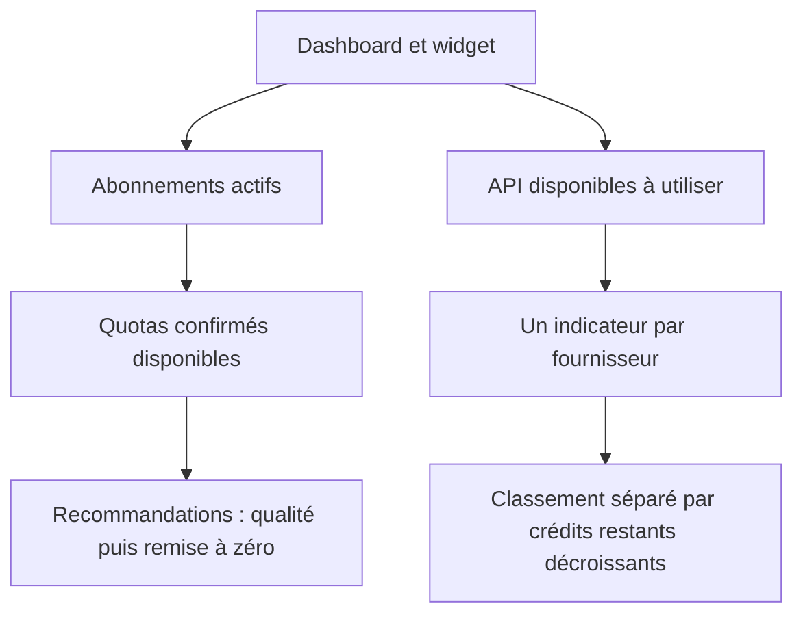

# Proposition d’ordre de consommation

État de la recherche : 12 septembre 2026. Cette méthode est intégrée au dashboard et au widget, sous forme de recommandations uniquement. Les modèles accessibles et les routes retenues se règlent dans l’application. Aucun appel de génération payant n’a été effectué pour cette comparaison.

## Principe

Les recommandations portent uniquement sur les abonnements actifs : choisir le meilleur modèle accessible parmi les quotas confirmés disponibles. Une section séparée « API disponibles à utiliser » affiche les fournisseurs selon leurs crédits USD restants, du solde le plus élevé au plus faible. Cette liste est informative et ne prend jamais la place d’un abonnement dans les propositions. Le profil de comparaison reste global, sans distinction par tâche.

Une limite horaire épuisée suffit à rendre un quota temporairement indisponible, même si la limite hebdomadaire reste positive. Une donnée absente ou périmée signifie « disponibilité à vérifier », jamais « 100 % disponible » ou « quota épuisé ».

## Abonnements : ordre de départ proposé

L’ordre ci-dessous reste conditionné aux modèles effectivement proposés dans chaque compte. Un catalogue public ou une fiche API ne prouve pas l’accès dans un abonnement précis.

| Priorité | Accès | Modèle à privilégier et condition |
| --- | --- | --- |
| 1 | Claude Pro | Claude Opus 5.5, si les limites de cinq heures et de la semaine sont lisibles dans le compte. |
| 2 | OpenAI Pro / Codex | GPT-6 Astra si disponible dans le sélecteur du compte ; sinon reclasser le meilleur modèle effectivement accessible. |
| 3 | Z.ai et Ollama | GLM-5.3 ; départager ces deux accès par le renouvellement connu de leurs quotas. |
| 4 | Grok | Grok 4.6 si inclus dans le compte. Kimi K3 via Ollama est une autre option de niveau comparable, dans le même portefeuille Ollama. |
| 5 | Antigravity, quota Gemini | Gemini 3.8 Flash, avec le niveau de raisonnement adapté au classement retenu. |
| Avant les API | Antigravity, quota Claude/GPT | Utiliser aussi ce quota indépendant si les accès mieux classés sont épuisés. Le catalogue consulté comprend notamment Claude Opus 4.6 Thinking ; ne pas le confondre avec une génération Claude plus récente. |

Repères de qualité consultés : Astra max 53, GLM-5.3 max 45, Grok 4.6 high 44, Kimi K3 max 44 et Gemini 3.8 Flash high 41 sur l’Intelligence Index v4.3. Ce sont des résultats d’évaluation à des réglages précis, pas une garantie de qualité universelle ni de performance identique dans les interfaces d’abonnement. [Évaluateur original : Artificial Analysis](https://artificialanalysis.ai/leaderboards/models).

Claude Opus 5.5 a été ajouté après sa sortie du 22 septembre 2026. Son rang provisoire juste au-dessus d’Astra est un choix de produit : [Anthropic publie](https://www.anthropic.com/claude-opus-5-5) des résultats supérieurs sur plusieurs évaluations de code et de travail général, avec des réglages de raisonnement qui diffèrent. La note interne 54 n’est pas un score Artificial Analysis directement comparable aux notes ci-dessus. La limite Claude Pro est partagée entre Claude Desktop, le web et Claude Code ; elle est distincte du quota Claude/GPT d’Antigravity.

Les offres publiques confirment plusieurs possibilités intéressantes : [Ollama Cloud](https://ollama.com/search?c=cloud) propose notamment GLM-5.3 et Kimi K3 ; les [plans Z.ai](https://docs.z.ai/devpack/overview) prennent en charge GLM-5.3 et GLM-5.3 Flash. GLM-5.3 consomme davantage de crédits que Flash, ce qui est cohérent avec la priorité donnée à la qualité dans les abonnements. Les modèles Antigravity sont à vérifier dans son [catalogue officiel](https://www.antigravity.google/docs/models/).

### Compter les quotas, pas seulement les modèles

- Deux modèles utilisant le même quota Codex ne constituent pas deux réserves indépendantes.
- GLM-5.3 et GLM-5.3 Flash sur Z.ai partagent les crédits du plan.
- Les différents modèles Ollama consomment le même portefeuille ; seuls les crédits inclus dans l’abonnement passent avant les API. Une recharge supplémentaire est une dépense distincte.
- Antigravity possède deux groupes à suivre : Gemini et Claude/GPT, chacun avec ses fenêtres applicables.
- Lorsque le quota d’un meilleur abonnement se renouvelle, il reprend sa priorité.

## API : sélection principale et tarifs vérifiés

Prix en dollars pour un million de tokens, hors outils, taxes et frais éventuels de recharge. « Total de référence » = un million de tokens d’entrée sans cache + un million de tokens de sortie facturés. C’est une convention de comparaison, pas le coût prédit d’une tâche.

| Modèle | Route observée | Entrée | Sortie | Total de référence |
| --- | --- | ---: | ---: | ---: |
| GLM-5.3 Flash | OrcaRouter | 0,075 $ | 0,250 $ | **0,325 $** |
| Qwen3.8 Flash | OrcaRouter ou OpenRouter | 0,150 $ | 0,470 $ | **0,620 $** |
| DeepSeek V4.1 Flash | DeepSeek / route au tarif réduit | 0,150 $ | 0,600 $ | **0,750 $** |
| GPT-5.6 Luna | OpenRouter ou OrcaRouter | 0,200 $ | 1,200 $ | **1,400 $** |
| DeepSeek V4.1 Flash | DeepSeek, heures pleines | 0,300 $ | 1,200 $ | **1,500 $** |
| Gemini 3.8 Flash | OpenRouter ou OrcaRouter | 0,750 $ | 3,750 $ | **4,500 $** |
| Muse Spark 1.3 standard | OpenRouter | 1,250 $ | 4,250 $ | **5,500 $** |

Sources : [catalogue public OrcaRouter](https://www.orcarouter.ai/models), [catalogue tarifé OpenRouter](https://openrouter.ai/api/v1/models), [tarification DeepSeek](https://api-docs.deepseek.com/quick_start/pricing/), [fiche officielle Luna](https://developers.openai.com/api/docs/models/gpt-5.6-luna).

Pour le même GLM-5.3 Flash, RunInfra affiche 0,10 $ / 0,40 $, soit 0,50 $ avec cette convention. Il constitue donc une autre route intéressante après OrcaRouter, devant la route OpenRouter observée à 0,15 $ / 0,50 $. [Tarifs RunInfra](https://runinfra.ai/pricing).

DeepSeek change de prix selon l’heure : heures pleines du lundi au vendredi, 01–04 h et 06–10 h UTC ; tarif réduit aux autres horaires. Vérifier le tarif propre à chaque revendeur avant de lui appliquer la remise du fournisseur direct. Le tarif Gemini 3.8 Flash consulté est temporaire jusqu’au 31 décembre 2026. [DeepSeek](https://api-docs.deepseek.com/quick_start/pricing/), [Google](https://ai.google.dev/gemini-api/docs/pricing).

### Place de Luna et Muse

Luna reste dans la sélection principale : il apporte une alternative OpenAI à prix contenu. Muse Spark 1.3 standard reste une option de qualité supérieure mais plus coûteuse. Sur l’évaluation consultée, Muse max obtient 48 contre 38 pour Luna max ; le prix par token ne suffit toutefois pas à prévoir le coût d’un travail terminé, car le nombre de tokens produits diffère. [Comparaison originale](https://artificialanalysis.ai/models/comparisons/muse-spark-1-3-vs-gpt-5-6-luna).

**Muse Spark 1.3 Contributor est une option séparée, désactivée par défaut.** Ses prix affichés sont 0,10 $ en entrée et 0,20 $ en sortie, soit 0,30 $ au total de référence. Cette offre autorise l’utilisation des entrées et sorties pour l’entraînement de Meta. Elle ne doit entrer dans la liste séparée des API disponibles qu’après accord explicite sur cette condition. Ne pas présenter le score de la version standard comme une évaluation indépendante de la route Contributor. [Conditions et tarifs Contributor](https://openrouter.ai/meta/muse-spark-1.3-contributor).

### Qualité et autres candidats

Les Flash demandés sont tous conservés. Repères consultés : GLM-5.3 Flash 42, Gemini 3.8 Flash high 41, DeepSeek V4.1 Flash max 40. Le score de Qwen3.8-Flash-Next ne doit pas être attribué à Qwen3.8 Flash : leur identité diffère et le score comparable de ce dernier reste à confirmer. [Artificial Analysis](https://artificialanalysis.ai/leaderboards/models).

MiniMax M3 et Step3.7 Flash restent des alternatives secondaires plutôt que des priorités automatiques. Les tarifs de base OpenRouter observés sont respectivement 0,30 $ / 1,20 $ et 0,20 $ / 1,15 $. Ils ne justifient pas de remplacer d’office la sélection Flash : M3 ressort à 30 dans la comparaison consultée et Step à 19 avec un résultat estimé dans le classement. [MiniMax, comparaison](https://artificialanalysis.ai/models/comparisons/gemini-3-8-flash-vs-minimax-m3), [classement](https://artificialanalysis.ai/leaderboards/models), [tarifs actuels OpenRouter](https://openrouter.ai/api/v1/models).

## Règles du futur moteur

1. Identifier séparément le modèle exact, le fournisseur qui l’héberge et le quota ou portefeuille utilisé.
2. Écarter les accès indisponibles, sans solde suffisant ou incompatibles avec les conditions acceptées. Signaler les informations non vérifiées.
3. Choisir d’abord parmi les abonnements utilisables, par qualité puis prochain renouvellement connu.
4. Indépendamment des recommandations, afficher les fournisseurs API disponibles selon leurs crédits USD restants décroissants, sans utiliser le prix des modèles comme critère. Sans abonnement utilisable, ne proposer aucune API dans la file d’usage.
5. Estimer le coût à partir d’un même profil global d’usage : entrée, cache lu/écrit, sortie facturée, raisonnement facturé et frais d’outils applicables. Les prix longs contextes et horaires peuvent modifier l’ordre. Ne pas compter deux fois le raisonnement déjà inclus dans la sortie facturée.
6. Distinguer une erreur propre à un modèle d’une panne de fournisseur ou d’un portefeuille épuisé : dans les deux derniers cas, changer de modèle sur le même accès ne résout pas le problème.
7. Réévaluer après un renouvellement, une panne, un changement de prix ou de solde. Ne pas organiser une rotation artificielle pour consommer tous les modèles.

La disponibilité publique et les prix ont été vérifiés sans génération payante. Les droits d’accès exacts de chaque compte et les fonctionnalités des routes retenues restent à confirmer dans leurs sélecteurs : configurer le modèle ou exclure la route dans Réglages. Le catalogue est embarqué et daté ; il n’est pas relu automatiquement sur Internet. Le profil de coût implémenté estime l’entrée sans cache, la lecture de cache et la sortie facturée ; l’écriture du cache et les outils restent exclus. Le classement ne déclenche ni appel, ni achat, ni recharge, ni changement de fournisseur.
