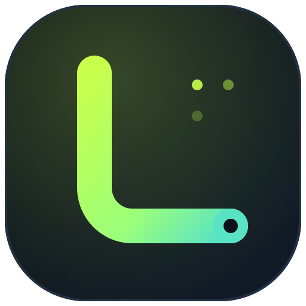

# Contrat UI du renderer — Lasmium TOKENS-HUB 0.4.0

Document de référence pour l'intégration de la refonte `refonte/pro`.
Propriétaire : `ux-docs` (`task-6`). Tout écart constaté par un autre agent doit être
signalé au Lead avant modification.

**Périmètre écrit :** `renderer/**`, `lib/resource-levels.js`,
`tests/resource-levels.test.cjs`. Aucune modification de `main.cjs`, `preload.cjs`,
`package.json`, des scripts de smoke ou des autres tests.

---

## 1. Fichiers et ordre de chargement

| Fichier | Rôle | Chargé par `renderer/index.html` |
|---|---|---|
| `renderer/theme-init.js` | résolution du thème **avant les CSS** (évite le flash) | ligne 9, sans `defer` |
| `renderer/styles.css` | base, mise en page, composants, widget compact, responsive | lignes 10 |
| `renderer/theme.css` | **tokens sémantiques** clair/sombre, typographie, rayons | ligne 11 |
| `../lib/quota-resets.js` | dates de réinitialisation (inchangé) | ligne 12 |
| `../lib/resource-levels.js` | seuils et libellés de niveau (étendu) | ligne 13 |
| `renderer/ui-core.js` | échappement, formatage, icônes, thème, focus, toasts, niveaux | ligne 14 |
| `renderer/reset-ui.js` | `resetMarkup` / `resetForm` (restructuré) | ligne 15 |
| `renderer/views-shell.js` | coquille : `NAV_LABELS`, `brand`, `heading`, `syncButton`, `nav`, `shell`, `resourceLegend`, `stats`, `toolbar` | ligne 16 |
| `renderer/views-cards.js` | cartes fournisseur : `statusBadge`, santé des connexions (`healthPanel`), groupes de quotas et niveaux (`providerResourceLevel`), notices, réserve Ollama, favoris, `card` / `expiredCard`, `filteredCards` | ligne 17 |
| `renderer/views-pages.js` | pages `overview`, `subscriptions`, `connections`, `historyPage` (graphe), `settingsPage` (section mises à jour), champs de formulaire (`inputField`, `selectField`) et fiche (`dialogMarkup`, onglets, corps de connexion) | ligne 18 |
| `renderer/views-quick.js` | widget compact : faits (`quickSubscriptionFacts`, `quickApiFacts`), `quickAccountRow`, `quickHeader` | ligne 19 |
| `renderer/app.js` | état, événements, boucle de rendu, actions | ligne 20 |

`renderer/views.js` **a été découpé** en quatre fichiers `views-*.js` regroupés par
responsabilité (déplacement pur : aucune fonction renommée, aucune signature changée,
rendu identique vérifié avant/après dans Chromium). Chaque fichier commence par un
commentaire d'en-tête qui liste son rôle et les scripts dont il dépend.

`renderer/strategy-ui.js` et `renderer/strategy.css` **ont été supprimés** en 0.3.4
avec toute la fonctionnalité d'ordre de consommation ; `../lib/usage-strategy.js`
n'est plus chargé par le renderer (le moteur reste côté `lib/` pour les tests et
l'export, mais l'UI ne l'appelle plus).

Ordre à respecter : `ui-core.js` avant `reset-ui.js` et les `views-*.js` ;
`views-shell.js` (constantes `NAV_LABELS` et `brand`) avant `views-cards.js`,
`views-pages.js` et `views-quick.js` ; les quatre `views-*.js` avant `app.js`.
Tous les scripts du renderer partagent la portée globale (aucun module, aucun
bundler) : les fonctions des `views-*.js` ne sont appelées qu'au rendu, jamais au
chargement, de sorte qu'aucune référence croisée entre ces fichiers (`filteredCards`
→ `card`, `overview` → `stats`/`toolbar`/`filteredCards`, `quickHeader` → `brand`,
`resetForm` → `inputField`) n'est résolue avant `start()` dans `app.js`. Aucun script
inline, aucun `eval`, aucune dépendance.

**Routes d'aperçu :** `scripts/preview.cjs` sert `/ui-core.js`, `/views-shell.js`,
`/views-cards.js`, `/views-pages.js`, `/views-quick.js`, `styles.css`, `theme.css`,
`theme-init.js`, `reset-ui.js`, les deux scripts `lib/` et les assets ; la liste est
fermée : tout nouveau `<script src>` de `index.html` doit y être ajouté
(`tests/quality.test.cjs` vérifie que chaque script existe, est couvert par
`scripts/check-syntax.cjs` et possède sa route). Les routes `strategy*` et
`usage-strategy` ont été retirées côté Lead.
`scripts/app-resources.cjs` copie tout `renderer/` : rien à ajouter pour le portable.

---

## 2. Globals et contrat JavaScript

Conservés tels quels (utilisés par `scripts/smoke.cjs`, `smoke-resource-status.cjs`
et `smoke-claude.cjs`) :

| Global | Type | Usage |
|---|---|---|
| `state` | variable globale assignable | état public ; le smoke la remplace et appelle `render()` |
| `page` | `'overview' \| 'subscriptions' \| 'history' \| 'connections' \| 'settings'` | page courante, assignable par le smoke |
| `filter` | `'all' \| 'subscription' \| 'api' \| 'favorite'` | filtre des cartes |
| `query` | chaîne | recherche |
| `render()` | fonction | rendu complet de la fenêtre principale |
| `renderQuick()` | fonction | rendu complet du widget |
| `receiveState(state)` | fonction | réception d'un état différé |
| `statusBadge(provider)` | fonction | badge textuel d'état (smoke l'appelle directement) |
| `QuotaResets`, `ResourceLevels` | globaux de `lib/` | inchangés |

`strategyResult()` et `UsageStrategy` **ne sont plus exposés** par le renderer :
la recommandation d'ordre de consommation a été retirée de l'UI en 0.3.4. Les tests
et le smoke qui s'appuyaient dessus doivent être mis à jour (voir §10).

Nouveaux helpers globaux (non contractuels, peuvent évoluer) :
`escapeHtml`, `money`, `shortDate`, `age`, `relativeAge`, `days`, `resetLabel`,
`icon`, `logo`, `meterMarkup`, `levelPill`, `freshnessMarkup`, `resourceClass`,
`toast`, `announce`, `captureFocus`, `restoreFocus`, `applyTheme`, `shell`, `card`,
`dialogMarkup`, `quickAccountRow`, `settingsPage`, `historyPage`, etc.

Fonctions supprimées ou renommées : `settings()` → `settingsPage(options)`,
`history()` → `historyPage()`, `brand` reste une constante, `applyTheme(value)` →
`applyTheme(preference, { persist })` (accepte `'light' | 'dark' | 'system'`),
`resourceLegend()` reste global. Aucune de ces fonctions n'est utilisée par les smoke.

---

## 3. Structure DOM de la fenêtre principale

```html
<div id="app">
  <a class="skip-link" href="#main-content">Aller au contenu</a>
  <div class="app-shell">
    <aside class="sidebar">
      <div class="brand"><span class="brand-logo"></span><span class="brand-text"><span class="brand-name">Lasmium</span><span class="brand-sub">TOKENS-HUB</span></span></div>
      <div class="workspace"><div class="workspace-text"><strong>Espace local</strong>…</div></div>
      <p class="nav-label">Navigation</p>
      <nav class="nav" aria-labelledby="nav-label-main">
        <button data-nav="overview" class="nav-link is-active" aria-current="page">…</button>
        <button data-nav="subscriptions">…</button>
        <button data-nav="history">…</button>
        <button data-nav="connections">…</button>
      </nav>
      <div class="sidebar-bottom">
        <nav class="nav nav-secondary" aria-label="Réglages">
          <button data-nav="settings">…</button>
        </nav>
        <p class="local-status">…</p>
      </div>
    </aside>
    <div class="main">
      <header class="topbar">…</header>
      <main class="content" id="main-content" tabindex="-1">…page…</main>
    </div>
  </div>
</div>
```

Sous 900 px CSS (fenêtre étroite **ou zoom 125/150/200 %**), `.sidebar` devient une
barre supérieure horizontale défilable : `.sidebar` n'est **jamais** `display:none`
et les cinq boutons `[data-nav]` restent visibles et focusables. Seuls
`.workspace`, `.nav-label` et `.local-status` (non navigables) sont masqués.

`#detail-dialog` (élément `<dialog>` déclaré dans `index.html`) contient :

```html
<div class="dialog-head">… <h2 id="detail-title">…</h2> …</div>
<div class="dialog-tabs" role="tablist" aria-label="Sections de la fiche">
  <button role="tab" id="tab-info" data-dialog-tab="info" aria-selected="true"
          aria-controls="dialog-panel" class="dialog-tab is-active">Informations</button>
  …
</div>
<div class="dialog-body" id="dialog-panel" role="tabpanel" aria-labelledby="tab-info" tabindex="0">…</div>
```

Le widget (fenêtre `?mode=quick`, **360×660** côté Electron) est rendu dans `#app` :
chaque fournisseur est une **ligne verticale** — en-tête (logo 20 px, nom, chip de
niveau) puis une ligne par information (label à gauche, valeur à droite, chiffres
tabulaires). Aucune information n'est masquée par un compteur « +N ».

```html
<main class="quick">
  <header class="quick-head">…<button data-action="sync" aria-label="Synchroniser">…</button></header>
  <p class="quick-refresh-status">Auto 5 min · Claude 1 min
    <span class="quick-count">10 comptes · 6 abonnements · 4 API</span></p>
  <div class="quick-list">
    <p class="quick-group-title">Abonnements</p>
    <button class="quick-row quick-row-stacked resource-healthy" data-provider="claude" data-action="main"
            title="Anthropic Claude — Hebdo : 40 % · Horaire : 80 % · Hebdo Fable : 30 % — Dernier relevé : …">
      <span class="quick-row-head">
        <span class="quick-provider">logo 20 px + <span class="provider-name">Anthropic Claude</span></span>
        <span class="level-pill resource-healthy quick-level" title="Ressource suffisante">Suffisant</span>
      </span>
      <span class="quick-facts">
        <span class="quick-fact"><span class="quick-fact-label">Hebdo</span>
          <span class="quick-fact-value resource-healthy">40<small>%</small></span></span>
        <span class="quick-fact"><span class="quick-fact-label">Horaire</span>
          <span class="quick-fact-value resource-healthy">80<small>%</small></span></span>
        <span class="quick-fact"><span class="quick-fact-label">Hebdo Fable</span>
          <span class="quick-fact-value resource-healthy">30<small>%</small></span></span>
      </span>
      <span class="sr-only">…</span>
    </button>
    <button class="quick-row quick-row-stacked resource-healthy" data-provider="ollama" …>
      <span class="quick-row-head">… Ollama …</span>
      <span class="quick-facts">
        <span class="quick-fact">… Limite Free 100 % …</span>
        <span class="quick-fact">… Crédits achetés 1,05 $US …</span>
      </span>
    </button>
    … (autres abonnements)
    <p class="quick-group-title">API</p>
    <button class="quick-row quick-row-stacked resource-low" data-provider="deepseek" …>
      <span class="quick-row-head">… DeepSeek Platform …</span>
      <span class="quick-facts">
        <span class="quick-fact">… USD 10,00 $US …</span>
        <span class="quick-fact">… CNY 42,50 CNY …</span>
      </span>
    </button>
    … (autres API)
  </div>
  <footer class="quick-footer"><button class="text-button" data-action="main">…</button></footer>
</main>
```

Une information unique (OpenAI, Grok, API mono-solde) est affichée en ligne dans
l'en-tête avec `.quick-fact-inline` pour garder une ligne basse ; une valeur
« Indisponible » n'est pas répétée en texte (le chip de niveau suffit). Toutes les
fenêtres et tous les soldes multi-devises sont visibles, sans agrégation.

Le widget **n'affiche plus de recommandation** : plus de « À utiliser maintenant »,
de « Puis », de classement ni de section « API disponibles à utiliser » ; c'est une
liste : abonnements d'abord, API ensuite. Le contenu d'un `.quick-row` est
exclusivement constitué d'éléments **phrasing** (`span`, `img`, `small`) : plus de
`<div>`/`<h3>` dans un `<button>`.

**Segmentation widget (T19)** : maximum **2 segments par ligne** (les plus
contraints, un seul par libellé agrégé — ex. plusieurs « Hebdo » Gemini/Claude →
minimum), affichés dans l'ordre de contrainte (`Hebdo 25 % · Horaire 80 %`), le reste
dans le `title` et le `.sr-only` de la ligne. `.quick-extra` compte les segments
supplémentaires non affichés (ex. `+1` pour Antigravity/Claude). Les fenêtres absentes
ne produisent jamais de ligne « — ».

---

## 4. Hooks DOM conservés (contrat §3.6)

Vérifiés par audit statique sur toutes les vues :

- Globals : `render`, `receiveState`, `state`, plus `renderQuick`,
  `statusBadge`, `page`, `filter`, `query` (héritage smoke).
  `strategyResult` et `UsageStrategy` ont été retirés (§10).
- Navigation : `[data-nav="overview|subscriptions|history|connections|settings"]`,
  `.sidebar`, `.workspace`, `#app`, `#detail-dialog`, `#toast`.
- Actions : `[data-action="sync|export|disconnect|account-open|
  account-verify|claude-enable-live|ollama-email|main|close-dialog|history-retry"]`
  (`strategy-settings` supprimé).
- Cartes : `.cards .card`, `.card.resource-{level}`, `.card-open[data-open]`,
  `.card-top`, `.card-content`, `.card-bottom`, `.card-error`, `.expired-card`,
  `.expired-row`, `.metric`, `.quota`, `.quota-period`, `.quota-period-label`,
  `.quota-period-value`, `.quota-period-status`, `.meter`, `.resource-value`,
  `.resource-status`, `.badge`, `.ollama-reserve.stale`.
- Recherche/filtres : `#search`, `[data-filter="all|subscription|api|favorite"]`,
  `[data-favorite]`, `.stats`, `.data-table`, `.data-table tbody tr`.
- Connexions : `.connection-card`, `[data-open]` avec `data-tab="connection"`,
  `.connection-success`, `.dialog-body`, `#api-key`, `#connection-form`,
  `#account-connection-progress`, `#orca-connection-progress`,
  `#ollama-connection-progress`.
- Fiche : `[data-dialog-tab="info|manual|resets|connection"]`, `#provider-form`
  (`#plan`, `#amount`, `#currency`, `#billingCycle`, `#renewalDate`, `#nextAmount`,
  `#priceChangeDate`, `#notes`, `#subscriptionStatus`, `#statusMessage`,
  `[name="reviewed"]`, `[name="confirmRenewal"]`, `[name="active"]`),
  `#manual-form` (`#balance`, `#quotaRemaining`, `#resetAt`), `#resets-form`
  (`#reset-date-N`, `#reset-time-N`), `.form-error`.
- Historique : `#history-provider`, `#history-period`, `.chart-panel`,
  `.chart-grid`, `.chart-line`, `.chart-point`, `.data-table`.
- Réglages : `#settings-form`, `[name="theme"]`, `[name="autoRefresh"]`,
  `[name="notifications"]`, `[name="lowBalance"]`, `[data-action="export"]`,
  `[data-action="erase-data"]` / `[data-action="erase-cancel"]`, `#app-version`.
- Widget vertical : `.quick`, `.quick-head`, `.quick-refresh-status`, `.quick-count`,
  `.quick-list`, `.quick-group-title`, `.quick-row` (+ `.quick-row-stacked`,
  `.resource-{level}`), `[data-provider]`, `.quick-row-head`, `.quick-provider`,
  `.provider-name`, `.quick-facts`, `.quick-fact`, `.quick-fact-label`,
  `.quick-fact-value`, `.quick-fact-inline`, `.quick-level`,
  `.quick-stale` et `[aria-label="Relevé à vérifier"]` (uniquement sur un relevé
  réellement ancien), `.quick-footer`. Plus de `.quick-value`, `.quick-segment`
  ni `.quick-extra` : toutes les fenêtres sont rendues.
- Textes conservés mot pour mot quand le smoke les vérifie (hors stratégie) :
  « Expiré · désactivé », « En pause », « Synchronisation… », « Relevé ancien »,
  « Connexion à vérifier », « Quota indisponible », « Free · 0 $ »,
  « Déconnecté · dernier relevé », « Synchronisé », « Saisie manuelle »,
  « Compte connecté », « À connecter », « Limite … atteinte »,
  « Limite hebdo Fable atteinte », « Toutes les limites atteintes »,
  « Limite atteinte », « Solde épuisé », « Crédits inclus épuisés ·
  réserve disponible », « Réserve supplémentaire », « Dernière valeur connue »,
  « Grok / Bot / Cursor », « Fin du forfait : … », « Free · 0 $/mo »,
  « Date passée · à vérifier », « heure non précisée », « manuel »,
  toasts « Préférences enregistrées. », « Dates de réinitialisation enregistrées. »,
  « Données exportées, sans les clés. » (`Stratégie enregistrée.` supprimé).

---

## 5. Hooks remplacés ou supprimés (0.3.4)

| Ancien | Nouveau | Raison | Impact smoke |
|---|---|---|---|
| `.strategy-panel`, `.strategy-current`, `.strategy-next`, `.strategy-api`, `.strategy-details`, `[data-disclosure="subscriptions"]` | **supprimés** du tableau de bord | demande utilisateur : plus de suggestion de modèle | `smoke.cjs:103,149,162-192,565-566,641` à supprimer/réécrire |
| `[data-action="strategy-settings"]`, `#strategy-form`, `#strategy-model-*`, `#strategy-inputTokens`, `[name="contributor"]`, `#strategy-form button[type=submit]` | **supprimés** des Réglages et des actions | plus de panneau d'ordre de consommation | `smoke.cjs:134-145,681-683` et `updateStrategy` à retirer du scénario |
| `.quick-strategy`, `.quick-api`, `.quick-api-providers`, `[data-api-provider]` | **supprimés** du widget (liste API sans classement) | plus de recommandation/classement | `smoke.cjs:562-566` à supprimer |
| `.quick-period`, `.quick-period-label`, `.quick-period-status`, `.quick-quota`, `.quick-values`, `.quick-freshness`, `.quick-group-label`, `.quick-ollama-reserve` | **supprimés** ; remplacés par `.quick-facts` / `.quick-fact` (une ligne par fenêtre, plus de compteur `+N`) | lisibilité complète : Claude, Antigravity, Ollama et soldes API | `smoke-resource-status.cjs` et `smoke.cjs` réécrits sur `.quick-fact` |
| `.quick-columns` | `.quick-refresh-status` + `.quick-count` (une seule ligne) | en-tête plus court | non utilisé tel quel par le smoke |
| Auto-dimensionnement via `fitQuick()`/`ResizeObserver` | **supprimé** : la fenêtre garde sa taille par défaut (360×660) | widget vertical complet et stable | `smoke.cjs` vérifie 360×660 et le défilement fin à 320 |
| `.quick-value` + 2 segments max + `.quick-extra` | **supprimés** : ligne verticale `.quick-row-stacked` avec `.quick-row-head` + `.quick-facts`, une information par fenêtre, `Ollama` (Limite Free + crédits achetés) et tous les soldes API visibles | demande utilisateur : toutes les informations par abonnement | `quick-fact-label/value`, `quick-fact-inline` (information unique), plus de `.quick-extra` |
| `.shell` | `.app-shell` | grille de page | non utilisé par le smoke |
| `.workspace` avec « L’atelier de Lasme » + avatar « L » | `.workspace` avec « Espace local » / « Données sur cet appareil » | marque neutre (§3.6) | **`scripts/smoke.cjs:24` doit changer** : `/Lasme/` → `/Espace local/` |
| `nav button.active`, `.filters button.active`, `.dialog-tabs button.active` | `.is-active` (+ `aria-current`/`aria-selected`) | convention d'état unique | non utilisé par le smoke |
| `.badge.error` / `.badge.warn` / `.badge.live` | `.badge-error` / `.badge-warn` / `.badge-live` | tokens sémantiques | non utilisé par le smoke |
| `.icon-button.selected` | `.icon-button.is-selected` | convention d'état | non utilisé par le smoke |
| `.resource-unverified` (opacity `.65`) | classe conservée mais **sans atténuation** ; `.is-stale` | contraste AA sur les relevés anciens | aucun test ne vérifie l'opacité |
| `.reset-date` toujours présent (même sans date) | **absent** si aucune date ; sinon `.reset-date` + `.reset-date-value`, `.is-past`, `.is-compact` | supprime le bruit « Date non fournie » ×5 | `smoke.cjs:450` reste vert (date manuelle zai) ; aucune assertion « Date non fournie » trouvée |
| `#settings` panneau unique + « Version 0.1.0 » | `#app-version` dynamique + panneau « À propos » + « Aucune télémétrie » + bouton `[data-action="erase-data"]` / `[data-action="erase-cancel"]` | version source unique et effacement RGPD | aucun test ne vérifie la version ; nouveaux hooks à couvrir par `quality.test.cjs` si souhaité |
| Thème `light|dark` | `light|dark|system` ; `data-theme-preference` sur `<html>` | suit Windows | `smoke.cjs:23` : le seed par défaut est `theme:'system'` ; remplacer par la valeur calculée ou forcer `light`. |
| `.sidebar` couleurs | **refonte 0.4.0** : rail obsidian sombre dans les deux thèmes (`--sidebar-bg`), logo Lasmium, wordmark Sora | limiter la casse smoke | `smoke.cjs:25` et `:422` restent verts |
| `styles.css` minifié | CSS lisible (aucune règle minifiée) | maintenabilité | — |

> Les hooks `.quota-period*`, `.resource-status`, `.level-pill`, `.connection-success`,
> `.dialog-body` et les globals `page`/`filter`/`query` restent valables côté cartes,
> fiches et smoke-claude. En revanche, `scripts/smoke-resource-status.cjs` s'appuyait
> sur les statuts **par fenêtre du widget** (`.quick-period-status`,
> `.quick-quota`) : ils n'existent plus dans le widget compact et doivent être
> réécrits (voir §10).

---

## 6. Comportement du thème

1. **Avant le premier rendu** : `theme-init.js` lit `localStorage['lasmium-theme']` (repli `providersbar-theme` dans `theme-init.js`)
   (`light`, `dark` ou `system`), résout `system` avec
   `matchMedia('(prefers-color-scheme: dark)')`, puis pose
   `<html data-theme="light|dark" data-theme-preference="light|dark|system">`.
   Aucun flash clair/sombre dans le cas normal.
2. **Après réception de l'état** : `app.js` appelle
   `applyTheme(state.settings.theme)`. `state.settings.theme` est la source de
   vérité ; `system` est résolu en direct et persisté tel quel dans
   `localStorage`.
3. **Changement Windows en direct** : `watchSystemTheme()` (ui-core) écoute
   `matchMedia` et met à jour le thème si la préférence est `system` ; `main.cjs`
   reste cohérent via `nativeTheme.shouldUseDarkColors` pour le fond natif.
4. **Réglages** : le select propose `Clair`, `Sombre`, `Système (Windows)` ; la
   valeur est envoyée à `settings:update` (main accepte `system`, contrat §3.2).
5. Les tests qui forcent `document.documentElement.dataset.theme` (smoke
   resource-status) continuent de fonctionner : les CSS ne dépendent que de
   l'attribut `data-theme`, jamais d'une variable JS.

**Contraste (WCAG 2.1, calculé) :** toutes les paires texte/fond des deux thèmes
sont ≥ 4,5:1, y compris `--text-muted`, placeholders, badges, pastilles de niveau,
axe de graphique et boutons `primary`/`danger`. L'indicateur de focus est ≥ 3:1
(`focus` clair `#0b57d0`, sombre `#ffd166`). Aucune donnée n'est atténuée par
`opacity` : un relevé ancien garde son contraste (badge dans les cartes, icône
`.quick-stale` avec `aria-label="Relevé à vérifier"` dans le widget).

---

## 7. Accessibilité livrée

- **Navigation toujours visible** : barre latérale ≥ 900 px, barre supérieure
  horizontale < 900 px ; jamais `display:none` ; lien d'évitement « Aller au contenu ».
- **Focus** : indicateur `:focus-visible` 3 px contrasté sur tous les contrôles ;
  `captureFocus()`/`restoreFocus()` sauvegardent le sélecteur stable
  (`data-nav`, `data-filter`, `data-favorite`, `data-open`, `data-action`,
  `data-dialog-tab`, `data-provider`, `id`, `name`) et la sélection de texte, puis le
  restaurent après chaque rendu complet (actions, IPC, timer 60 s). Le dialogue
  restaure aussi le focus après reconstruction d'onglet.
- **ARIA** : navigation principale nommée + navigation Réglages nommée ; `aria-current`
  sur la page active ; `aria-pressed` sur filtres et favoris ; onglets de fiche
  `role="tablist/tab/tabpanel"` + `aria-selected` + `aria-controls`, flèches
  gauche/droite/Début/Fin ; `role="meter"` avec `aria-valuenow/min/max/valuetext`
  dans les cartes (le widget compact n'affiche plus de jauge) ; `aria-live` global
  `#live-region` pour filtres, recherche, synchronisation, vérification et effacement ;
  `role="alert"` sur les erreurs de formulaire ; `aria-busy` sur les boutons de
  synchronisation ; toasts `role="status"` ; lignes du widget = boutons nommés
  « fournisseur + résumé » et `title` détaillant toutes les fenêtres/soldes.
- **Pas de couleur seule** : `.level-pill` écrit « Épuisé / Critique / Bas / Suffisant »,
  `Indisponible`, `aria-valuetext` inclut le seuil, `resource-status` et
  `quota-period-status` sont textuels, le widget affiche toujours `.quick-level`
  (même vocabulaire), la légende complète est affichée sur Vue d'ensemble **et** dans
  Réglages ; un relevé ancien est signalé par une icône avec `aria-label`.
- **Typographie** : **Inter Variable** (texte, poids 100–900) et **Sora Variable** (titres, chiffres et marque, poids 100–800, licence OFL ;
  `font-display:swap`, repli Segoe UI/system-ui), `tabular-nums` pour les chiffres ;
  plancher 11 px (`--text-xs`), 12 px pour les libellés, 13 px de corps, 15–26 px
  pour les titres ; aucune règle à 8, 9 ou 10 px.
- **Cibles** : boutons ≥ 32–34 px, liens de navigation ≥ 38 px, cases à cocher 18–20 px
  dans une ligne `.check-row`.
- **Mouvement** : `prefers-reduced-motion` neutralise transitions et animations
  (y compris le chargement). `forced-colors` ajoute bordures et `Highlight` aux
  composants critiques.
- **Langue** : `<html lang="fr">`, textes UI en français, dates/monnaies `fr-FR`.
- **Logos** : `alt=""` quand le nom du fournisseur est adjacent (décoratif) ; dans le
  widget le logo et le nom sont dans le même bouton `.quick-row` (nom accessible
  complet), aucun logo n'est la seule identification d'un bouton.

---

## 8. Widget compact : dimensions, contenu, défilement

- **Dimensions cibles : 360 × 520 px** (fenêtre Electron modifiée par l'architecte en
  parallèle). Le rendu a été mesuré au format 360×520, échelle 1× et 2×, via le
  serveur d'aperçu : capture `test-results/widget-compact.png`.
- **Aucun auto-dimensionnement** : `fitQuick()`/`ResizeObserver` ont été retirés du
  renderer ; la fenêtre garde sa taille par défaut. La liste ne défile que si le
  contenu dépasse réellement (`scrollHeight <= clientHeight` attendu en 360×520), avec
  une barre fine de 5 px (`.quick-list::-webkit-scrollbar`, `scrollbar-width: thin`).
- **Structure** : en-tête 26 px (marque + bouton synchroniser 26 px), une ligne de
  statut (`Auto 5 min · Claude 1 min` ou `Actualisation désactivée`) suivie du compte
  `N comptes · X abonnements · Y API`, puis la liste :
  - titre `Abonnements` (11 px, capitales) et les abonnements actifs (6 en seed) ;
  - titre `API` et les accès API actifs (4 en seed), avec leur solde.
  L'ordre suit l'inventaire ; aucun classement, aucune recommandation, aucun « À
  utiliser maintenant / Puis ».
- **Lignes** : 36 px (plafond 40 px), contenu uniquement phrasing (`span`, `img`,
  `small`). Icône 20×20 px dans un carré de 24 px, nom 12 px tronqué par ellipsis,
  à droite une colonne de 186 px max : chip de niveau (11 px) puis **segments**
  (11–12 px, tabular-nums).
  - Segments : maximum **2 par ligne**, un seul par libellé agrégé (plusieurs
    « Hebdo » Gemini/Claude → le minimum), les plus contraints d'abord
    (`Hebdo 25 % · Horaire 80 %`) ; `.quick-extra` indique le nombre de segments
    supplémentaires non affichés ; tout le détail (libellé, groupe, %) est répété
    dans le `title` et un `.sr-only` de la ligne.
  - API : solde le plus contraint (`74,50 $US`) + chip, autres devises en `+N`/title.
  - Quota/solde inconnu : chip « Indisponible » + « — » (texte accessible), aucune
    barre, aucun faux pourcentage.
  - Relevé ancien/erreur : icône d'avertissement `.quick-stale` avec
    `aria-label="Relevé à vérifier"` ; sinon l'heure du relevé reste dans le `title`.
- **État vide** : « Aucun compte à afficher. »
- **Actualisation** : `.quick-refresh-status` reflète `state.settings.autoRefresh`
  (« Auto 5 min · Claude 1 min » ou « Actualisation désactivée »).
- **Accessibilité** : chaque ligne est un bouton `[data-provider][data-action="main"]`
  dont le nom accessible contient fournisseur + résumé ; `aria-busy` sur le bouton de
  synchronisation ; `:focus-visible` conservé ; aucun texte < 11 px.

### 8.1 Police Inter Variable et chips de statut (T19)

- **Police** : `@font-face` en tête de `renderer/styles.css` :
  `font-family:"Inter Variable"`, `src:url("../assets/fonts/InterVariable.woff2")` et `SoraVariable.woff2`,
  `font-weight:100 900`, `font-style:normal`, `font-display:swap`. `--font-ui`
  commence par `"Inter Variable", "Inter"` puis repli Segoe UI/system-ui. Appliquée
  au `body` (donc tableau de bord **et** widget), avec
  `font-variant-numeric: tabular-nums` pour tous les chiffres. Aucun réseau : CSP
  `'self'`, fichier embarqué (`assets/fonts/LICENSE-Inter.txt` conservé).
  Vérification : `document.fonts.check('400 13px "Inter Variable"')` doit valoir
  `true` (aperçu et widget) — voir la réserve MIME de l'aperçu au §10.
- **Chips de statut** : `.level-pill` unique pour cartes, widget, légende des Réglages
  et fiche. Fond teinté `--resource-bg`, bordure `color-mix(currentColor 55%)`,
  point de 6 px (`::before`), texte 11 px (700), `title` explicite
  (« Ressource suffisante », « Bas · ≤ 5 USD », « Critique · ≤ 10 % »,
  « Ressource épuisée », « Donnée indisponible »). Dans le widget :
  `.level-pill.quick-level` en 11 px compact. Le texte du niveau reste toujours
  visible et lisible sans la couleur (AA conservé).
- **Libellés exacts** : `Semaine` → **Hebdo**, `5 heures` → **Horaire**,
  `Fable · Semaine` → **Hebdo Fable**, `Gemini 4 Argon · Semaine` → **Hebdo Argon**
  (groupe Antigravity « Argon » conservé). Ordre des fenêtres : Hebdo avant Horaire.
  Une fenêtre absente n'est jamais rendue (aucune ligne « — » quand d'autres existent).

---

## 9. Réglages : version, marque neutre, effacement

- **Version dynamique** : `window.lasmium.getAppInfo()` → `#app-version`
  (« Version 0.3.0 »), avec repli sur `state.app.version`, puis « Version non exposée »
  si les deux sont absents. Aucune version en dur dans le renderer.
- **Marque neutre** : plus de « L'atelier de Lasme », plus d'avatar « L » ;
  l'espace local est présenté comme « Espace local ».
- **Effacement** : bouton « Effacer mes données » → premier clic : zone
  `role="alert"` de confirmation + boutons « Annuler » / « Effacer définitivement » ;
  second clic : `eraseData()` ; message de succès, rechargement de l'état, annonce
  live. Si l'API est absente (aperçu / version antérieure), toast explicite.
  Un délai de 10 s annule la confirmation.
- **Télémétrie** : mention explicite « Aucune télémétrie : Lasmium TOKENS-HUB n'envoie
  aucune donnée d'usage à un serveur Lasmium TOKENS-HUB. »
- **Export** : bouton `[data-action="export"]` conservé (historique + réglages).
- **Thème** : select à trois valeurs (`light`, `dark`, `system`).
- **Ordre de consommation retiré** : le formulaire `#strategy-form` (modèles,
  exclusions, routes, profil de tokens, Contributor) n'est plus rendu dans Réglages,
  et l'action `[data-action="strategy-settings"]` a disparu du tableau de bord.

### 9.1 Repli Claude Desktop après activation de la lecture directe

Depuis T9, `main.cjs` peut basculer explicitement en lecture Claude Desktop quand
le renouvellement du jeton Claude Code est refusé : l'état retourné par
`claude:enable-live` contient alors `provider.accountSession.kind =
'claude-desktop-local'` et `provider.accountConnection.message =
« Lecture directe indisponible (renouvellement du jeton Claude Code limité) ;
Lasmium TOKENS-HUB utilise le relevé Claude Desktop. »`.

Le renderer (`renderer/app.js`, branche `claude-enable-live` de `runAction`) lit
cet état après l'appel et applique deux retours distincts :

| État retourné | Toast (rôle `status`, `#toast`) |
|---|---|
| lecture directe réellement active (`accountSession.kind === 'claude-live-local'`) | « Lecture directe Claude activée. » (inchangé) |
| bascule Desktop, tout autre cas | « Connexion Claude mise à jour : relevé Claude Desktop utilisé. » |

Aucun message « lecture directe active » n'est affiché en cas de bascule. La fiche
Claude rend toujours le message de bascule via
`provider.accountConnection.message` (paragraphe `role="status"` dans l'onglet
Connexion) ainsi que « Suivi Claude Desktop activé sur ce PC » dans
`.connection-success` ; `renderDialog()` est appelé avant le toast pour que la fiche
soit déjà à jour. Aucun hook DOM nouveau : `[data-action="claude-enable-live"]`,
`#account-account-error` et `#toast` sont inchangés.

---

## 10. Points à mettre à jour dans les scripts (hors périmètre ux-docs)

### `scripts/smoke.cjs`

**Bloc stratégie à supprimer/réécrire** (fonctionnalité retirée) :
- `:103` `.strategy-panel` / « Abonnements à vérifier » ;
- `:134-145` clic `[data-action="strategy-settings"]`, assertions `#strategy-form`,
  `#strategy-model-ollama`, `#strategy-inputTokens`, `updateStrategy`, état `strategy` ;
- `:149` `strategyVisualOriginal` ;
- `:162-192` `.strategy-current`, `.strategy-next li`, `.strategy-api`,
  `.strategy-details`, `UsageStrategy.recommend`, `strategyResult`, captures
  `strategy-dashboard.png` / `strategy-api.png` ;
- `:562-566` `.quick-strategy`, `[data-api-provider]`, comparaison de recommandation
  entre tableau de bord et widget ;
- `:641` `strategyResult().queue` / `apiProviders` ;
- `:681-683` persistance `loaded.strategy`.

**Widget compact — assertions à adapter** :
- `:443-444` `.quick-row` count 10 et ordre : conservés (abonnements en tête puis API
  dans l'ordre de l'inventaire).
- `:449` l'assertion d'absence de fraîcheur devient sans objet : la fraîcheur n'est
  plus affichée en permanence (seul un indicateur « Relevé à vérifier » apparaît si
  nécessaire). Supprimer cette ligne.
- `:451-452, 464, 511-518, 526` : plus de `fitQuick()` ni de redimensionnement
  automatique ; remplacer par `assert.ok(scrollHeight <= clientHeight)` à 360×520
  (la fenêtre de test doit être dimensionnée en 360×520) et vérifier que
  `.quick-footer` reste visible.
- `:562-566` supprimés (voir bloc stratégie) ; `:467` `.logo img` = 10 logos conservé.
- `:492-504` : plus de `.quick-quota`, `.quick-period-status` ni `.quick-resource-status`
  côté widget. Vérifier à la place `.quick-row[data-provider]` (classe
  `resource-*`), `.quick-value` (texte « Épuisé/Bas/Critique ») et, pour les soldes,
  `.quick-value .resource-value` (couleur rouge des soldes négatifs conservée).
- `:637` (pastille) et `:589` (toast masqué) restent valables.

**Conservé** : `:24-25` (`.workspace` → remplacer `/Lasme/` par `/Espace local/`),
`:23` (thème système à calculer), `.cards .card`, filtres, recherche, fiches,
historique, connexions, réglages, toasts existants, `:467` logos.

### `scripts/smoke-resource-status.cjs`

**À réécrire pour la partie widget** : le script vérifie aujourd'hui, dans
`.quick-row`, des statuts par fenêtre (`.quick-quota`, `.quick-period-status`,
`.quick-resource-status`), qui n'existent plus. Conserver les vérifications des
cartes (`.card.resource-*`, `.quota-period-status`, `.resource-status`,
`.resource-value`, `.level-pill`) et adapter le widget à `.quick-row.resource-*` +
`.quick-value` / `.quick-level` (et `.resource-value` pour les soldes). Les fixtures
USD/négatives restent valables.

### Impacts T19 (segmentation, chips, police) — pour T20/qualite-tests

- **Libellés** : plus aucun « 5 h » affiché. Les attentes qui contiennent encore
  « 5 h » doivent devenir « Horaire » ; `Gemini 4 Argon · Semaine` devient
  « Hebdo Argon » ; `Hebdo Fable` reste distinct de `Hebdo`.
- `scripts/smoke-resource-status.cjs:54-56` : les statuts attendus deviennent
  « Limite horaire atteinte » (au lieu de « Limite 5 h atteinte ») et
  « Limite hebdo Argon atteinte » (au lieu de « Limite Gemini 4 Argon · hebdo atteinte »).
- `scripts/smoke-resource-status.cjs:74` : `exhausted.endsWith('5 heures')` →
  libellé **Horaire** ; `Gemini 4 Argon · Semaine` → **Hebdo Argon**.
- `scripts/smoke-resource-status.cjs:76` : `.quick-extra` ne vaut plus
  `windows.length - 1` mais le nombre de **segments** supplémentaires non affichés
  (max 2 affichés, un par libellé agrégé : `Math.max(0, categories - 2)`, souvent
  `+1` à 5 fenêtres).
- `scripts/smoke.cjs:643` : `.quick-extra` Antigravity (`+4` attendu) devient `+1`
  (5 fenêtres → 3 segments agrégés → 2 affichés).
- `scripts/smoke.cjs:641` : `.quick-value-label` peut être `Hebdo` (inchangé) mais
  les fixtures Horaire/Argon produisent respectivement `Horaire` / `Hebdo Argon`.
- Les `.quick-value-label`/`.quick-value-main` restent le segment le plus contraint ;
  `.quick-segment-label`/`.quick-segment-value` portent le second segment.
- `.level-pill` reste la classe des chips (cartes, widget, légende, fiche) : les
  textes restent « Épuisé / Critique / Bas / Suffisant / Indisponible » et passent
  toujours le contrôle `smoke.cjs:655`.
- La police Inter ne change aucun sélecteur ; ajouter si souhaité une assertion
  `document.fonts.check('400 13px "Inter Variable"') === true` (aperçu **avec MIME
  corrigé**, voir ci-dessous).
- **`scripts/preview.cjs` — correctif requis par le Lead** : la route
  `/assets/fonts/InterVariable.woff2` existe mais le serveur renvoie **500** car la
  table des `Content-Type` ne connaît pas l'extension `woff2`. Ajouter
  `'woff2': 'font/woff2'` au mapping (sans quoi `@font-face` échoue et
  `document.fonts.check` reste `false`).

### `scripts/smoke-claude.cjs`

Aucun changement attendu : `.dialog-body`, `.connection-success`,
`#account-account-error`, textes « chaque minute », « 39 % utilisés » et
« Prochaine tentative » sont conservés.

### `scripts/preview.cjs`

Le Lead a déjà ajouté `/ui-core.js`, les routes `/views-*.js` (quatre fichiers depuis
le découpage de `views.js`) et la route du fichier de police.
**Un correctif MIME reste nécessaire** : `'woff2': 'font/woff2'` dans le mapping des
`Content-Type`, sinon la route de la police répond 500 (vérifié) et le navigateur
utilise le repli Segoe UI. Aucune modification du renderer n'est requise.

### `main.cjs` (architecte)

- **Fenêtre widget** : faite — `main.cjs` crée `quickWindow` en **360×520**
  (`width: 360`, `height: Math.min(520, …)`, `quickDesiredHeight = 520`). Le renderer
  n'appelle plus `fitQuick`/`window:quick-size` ; l'API preload reste exposée mais
  n'est plus utilisée par le renderer actuel.
- Optionnel : abaisser `minWidth` de la fenêtre principale de 900 à ~720 px ; le
  renderer gère déjà les largeurs < 900 px (barre supérieure).

### `scripts/quality.test.cjs` (qualite-tests)

Si ce test vérifie la taille/les lignes du renderer, cibles actuelles :
`renderer/app.js` 561 lignes (max 112 car./ligne), les vues découpées en
`renderer/views-shell.js` (≈ 146 lignes), `views-cards.js` (≈ 476), `views-pages.js`
(≈ 590) et `views-quick.js` (≈ 125) (max ~142 car./ligne),
`renderer/ui-core.js` 310 lignes, `renderer/styles.css` 1 315 lignes,
`renderer/theme.css` 122. `renderer/strategy-ui.js` et `renderer/strategy.css`
n'existent plus ; `lib/usage-strategy.js` a également été retiré du dépôt par la
vague produit. La CSP de `index.html` n'a pas changé.

---

## 11. Vérifications effectuées (sans lancer l'application)

| Vérification | Commande / méthode | Résultat |
|---|---|---|
| Syntaxe JS | `node --check` sur `app.js`, `views-shell.js`, `views-cards.js`, `views-pages.js`, `views-quick.js`, `ui-core.js`, `reset-ui.js`, `theme-init.js` | OK |
| Tests ciblés | `node --test tests/resource-levels.test.cjs` | 6/6 verts |
| Rendu statique | harnais Node + `vm` avec DOM factice : `overview`, `subscriptions`, `connections`, `historyPage`, `settingsPage`, 10 `quickAccountRow`, 40 `dialogMarkup`, `shell` | aucune exception ; aucun `undefined`/`NaN` ; aucun appel `UsageStrategy` |
| Application | harnais `vm` chargeant `app.js` avec API simulée | rendu initial, `openDetail`, changement de page, `receiveState`, effacement, repli Claude sans erreur |
| Widget compact | harnais `vm` en `?mode=quick` | 10 `.quick-row` (6 abonnements + 4 API), 2 `.quick-group-title`, `.quick-refresh-status`, aucune section stratégie |
| **Chromium réel** (aperçu) | 360×520 @1x et @2x : `scrollHeight <= clientHeight`, chevauchement, hauteur des lignes, logos | 10 lignes (6 abonnements + 4 API), 2 titres de section, **hauteurs 36 px**, **liste 421 px / 421 px = aucun défilement**, 0 chevauchement, 10 logos chargés et visibles (20×20 px), footer dans la fenêtre, `scrollbar-width: thin` + règle `::-webkit-scrollbar` 5 px ; capture `test-results/after-widget.png` |
| Petite hauteur | 360×320 : débordement volontaire | la liste défile (`overflow-y:auto`) sans chevauchement ; à 520 px elle ne défile pas |
| États connus | quotas %, crédits USD, fenêtres multiples (Antigravity 5, Claude 3, Z.ai 2) | 10 lignes de 36 px, 0 débordement, segments « Hebdo 25 % · Horaire 80 % +1 », « 2,00 $US · Critique +1 » |
| **Libellés** | cartes Claude/Antigravity + widget | Claude : **Hebdo, Horaire, Hebdo Fable** ; Antigravity : Gemini (Hebdo/Horaire), Claude / GPT (Hebdo/Horaire), groupe Argon + **Hebdo Argon** ; aucune occurrence de « 5 h » (grep et innerText) ; fenêtre absente = aucune ligne « — » |
| **Chips** | rendu Chromium + inspection | `.level-pill` partout (cartes, widget, légende, fiche), fond teinté, bordure 55 %, point 6 px, texte 11 px, `title` explicite (« Ressource suffisante », « Bas · ≤ 5 USD », « Critique · ≤ 10 % », « Ressource épuisée », « Donnée indisponible ») |
| **Police** | `document.fonts.check('400 13px "Inter Variable"')` + `getComputedStyle` | `true` dans le dashboard et le widget, famille `"Inter Variable", Inter, "Segoe UI"…`, `tabular-nums` actif — **vérifié avec interception de la route police** car l'aperçu renvoie 500 (MIME manquant, cf. §10) ; captures avec la police réelle |
| **Captures** | Chromium Playwright | `before-claude-card.png`, `before-antigravity-card.png`, `before-widget.png` (avant) ; `after-claude-card.png`, `after-antigravity-card.png`, `after-widget.png`, `after-claude-dialog.png` (après, 2×) |
| Tableau de bord / Réglages | Chromium 1280×900 : absence `.strategy-*` / `#strategy-form`, 10 cartes, filtres | OK |
| Résidus | `grep -R "strategy\|UsageStrategy\|updateStrategy" renderer/*.js renderer/*.html renderer/*.css` | 0 résultat (seul le présent document mentionne l'historique) |
| Couleurs | calcul WCAG sur les tokens | 58 paires ≥ 4,5:1 (focus ≥ 3:1) ; chips AA (texte sur `--resource-bg`) |
| CSP | inspection `renderer/*` | aucun handler inline, `eval`, `new Function`, URL externe ; seul `fetch('/preview-state')` same-origin ; police `../assets/fonts/` = `'self'` |

**Non vérifié (nécessite l'application Electron) :** rendu dans la fenêtre Electron
réelle (taille 360×520 dépend de la modification `main.cjs` par l'architecte), zoom,
lecteur d'écran NVDA/Narrator, smoke complet. Ces points sont à valider par le Lead.

---

## 12. Risques et points de vigilance

1. **Aperçu : MIME de la police** — `/assets/fonts/InterVariable.woff2` répond 500
   car `scripts/preview.cjs` ne mappe pas `woff2`. Sans ajout de
   `'woff2': 'font/woff2'`, l'aperçu utilise le repli Segoe UI et
   `document.fonts.check` reste `false` ; le renderer et l'application Electron
   (fichier local) ne sont pas affectés. Correctif Lead attendu.
2. **Fenêtre Electron** : `main.cjs` crée bien le widget en 360×520 (vérifié le
   4 novembre 2026) ; le renderer a été validé dans ce format via l'aperçu. Si une
   ancienne version du renderer reste en cache dans un portable déjà construit, elle
   continuera d'appeler `fitQuick` : reconstruire les ressources (`npm run
   update:portable`) pour propager le nouveau widget compact.
3. **`scripts/smoke.cjs` / `smoke-resource-status.cjs`** : les libellés `5 h` →
   `Horaire`, `Gemini 4 Argon` → `Hebdo Argon`, les chips et la sémantique de
   `.quick-extra` (segments masqués, plus `windows-1`) changent des attentes
   explicites ; détail §10. T20/qualite-tests doivent adapter ces assertions.
4. **Thème système au premier lancement** : si Windows est en mode sombre,
   `dataset.theme` vaut `dark` avant toute interaction ; les tests existants qui
   supposent `light` doivent forcer la préférence.
5. **Double confirmation d'effacement** : le main refuse l'effacement pendant une
   synchronisation ; le message d'erreur est affiché dans `#erase-error`, mais le
   bouton reste actif pendant la synchro.
6. **`state.providers` partiellement migré** : le renderer tolère `amount`/`currency`/
   `nextAmount` absents, mais pas un `billingCycle` inconnu au-delà du libellé par
   défaut ; une migration `lib/migrations.cjs` peut rester nécessaire.
7. **Widget fixe sans auto-fit** : si les textes système sont agrandis (zoom), les
   10 lignes peuvent dépasser 520 px ; la liste défile alors avec une barre fine
   (comportement voulu). Aucun élément n'est coupé horizontalement (testé 360 px).
8. **Police absente du paquet** : si `assets/fonts/InterVariable.woff2` manque à la
   distribution, le repli Segoe UI/system-ui s'applique (aucun chargement réseau) ;
   conserver `assets/fonts/LICENSE-Inter.txt` avec le portable.
9. **Aucun test automatisé du nouveau code renderer** : le harnais statique et les
   mesures Chromium ne remplacent pas le smoke Electron. Le Lead doit lancer
   `npm run test:desktop`, `npm run test:resources:desktop` et
   `npm run test:claude:desktop` après mise à jour des scripts.

---

## 13. Captures / revue visuelle

- **Avant/après T19** dans `test-results/` (via Playwright, aperçu Chromium,
  `deviceScaleFactor: 2`, fixtures de quotas) :
  - `before-claude-card.png` / `after-claude-card.png` — carte Claude avec
    Hebdo, Horaire, Hebdo Fable, chips ;
  - `before-antigravity-card.png` / `after-antigravity-card.png` — groupes Gemini,
    Claude / GPT, Argon + Hebdo Argon ;
  - `before-widget.png` / `after-widget.png` — widget 360×520 @2x, 10 fournisseurs,
    2 sections, segments et chips ;
  - `after-claude-dialog.png` — chip de statut dans la fiche.
- Captures Lead à régénérer après correctif MIME : `ui-widget-light.png`,
  `ui-widget-rows.png`, `quick.png`, `compact-window.png`, `settings-*.png`,
  `widget-compact.png` ; elles ne doivent plus montrer de panneau « Ton ordre
  d'usage » ni de section recommandation, et doivent afficher Inter Variable.
- Points visuels : widget 360×520 sans défilement, icônes 20 px visibles, lignes
  36 px, en-tête court, chips AA, libellés Hebdo/Horaire/Hebdo Fable/Hebdo Argon,
  tableau de bord sans encart recommandation, thème clair et sombre.
